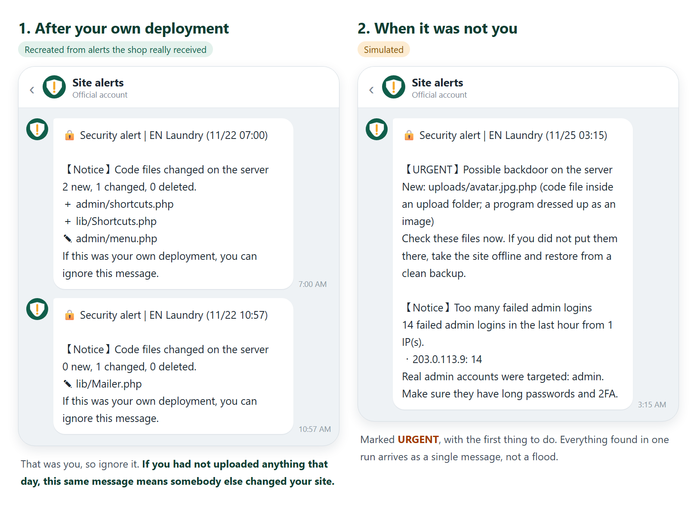

# LINE Security Alerts — hear about trouble on your website, on LINE

[中文](README.md)

Intrusion alerts for small PHP websites (online shops, booking sites, self-hosted CMSs). Silent
while everything is normal; when something looks wrong you get one LINE message saying what
happened and what to do first.

It started at **沂恩精緻洗衣 (EN Laundry)**, a laundry shop in Taiwan. A small business has no
security team and nobody reads server logs, but everybody reads LINE. It worked well for us, so
here is a generic version for anyone.

## A real example



**Left: recreated from the alerts the shop really received on one ordinary day** (file names and
counts made generic):

- A new admin feature was uploaded the evening before; the 7:00 AM scheduled check listed exactly
  which files were new and which had changed.
- One more file was updated later that morning; another notice arrived at the next check. (How often
  files are checked is up to you — every hour by default — and you can run a check by hand at any time.)

Both were the owner's own work, so a glance and a swipe is all they need. **That is exactly why it
is useful**: every time code on the site changes, you hear about it. The day you receive the same
message without having uploaded anything, somebody else changed your site — and you know that day,
not months later.

**Right: a simulation of "it was not you"** — a program dressed up as an image appears in the upload
folder while someone is guessing the admin password. The message is marked URGENT, everything found
in one run arrives as a single message, and it tells you what to do first.

Replay it yourself (no LINE account, no network, no real website involved):

```
php skills/line-security-alerts/scripts/demo.php --site="My Shop"
```

Every message in the picture is the real output of that demo script, not separately written copy.

**And when nothing is wrong?** Silence, except one check-in a week. A week without it tells you the
checks have stopped:

```
✅ Weekly check-in | EN Laundry (11/28 09:05)

Still on duty. Last 7 day(s): 2016 checks run, 4 thing(s) reported (1 urgent).
Watching 1850 code files; last full scan 11/28 07:00.
Code fingerprint: 3f9a-0c1d-77b2-e4a8. It comes with every check-in from now on; scroll up to compare with the one before.
LINE messages this month: about 37 of 200 used.
Records go back to 2026-11-20. If that date is newer than you remember, the records were reset: ask why.
You get this once a week. If a week passes without it, the checks have stopped running.
```

The line about LINE messages is asked from LINE once a week: an official account may only send so
many messages a month, and once they are used up nothing is delivered. From 80% on it becomes a
warning, in time to raise the plan or make sure the fallback e-mail is set.

What to do when a message arrives is written up for owners, not programmers:
**[When an alert arrives](skills/line-security-alerts/reference/when-an-alert-arrives.md)** (keep it on your phone).

### What is that "code fingerprint"?

Every code file on the site, boiled down to one short string. Change, add or delete any one of them
and the string changes.

The point: **the string is kept in your LINE chat history, not on the server.** Someone who breaks
in can change code and also edit the monitor's records so that everything "looks fine" — but they
cannot edit last week's message on your phone.

You do not have to compare by hand; the message states the conclusion:

| The message says | Meaning |
|---|---|
| same as the last check-in | No code changed this week |
| was xxxx; N code-change notice(s) were sent in between | It changed and you were told. If those were your own uploads, fine |
| was xxxx; N change(s) were written to the log but not sent | Files the site rewrites by itself, or the daily cap was reached. Have your developer read the log |
| ⚠ it changed, yet no code change is on record | The monitor's records may have been edited. Handle it as "possible backdoor" |

To check for yourself, scroll up to the previous check-in and compare the two strings. Your
developer can also compute the same string from the clean source on their own computer and compare
it with the one in LINE (see [integration.md, section 10](skills/line-security-alerts/reference/integration.md)):
if they are equal, the code on the server is exactly what you uploaded.

### When the schedule itself stops: outside check-in

The weekly check-in has one weakness: if the cron job dies, you only find out when "this week's
message did not come". To know sooner, use a "cron check-in" service such as healthchecks.io (it has
a free plan): it gives you an address, you put it in `ping_url`, and the module calls it after every
completed run. When the calls stop for longer than you allow (suggested: expected every 5 minutes,
10 minutes of grace), that service e-mails you or notifies you the way you chose.

It is optional; without it the module never connects anywhere but LINE. A failed check-in never
affects the checks, and the address is never written to a record or a message. If the address is
wrong and keeps failing, the weekly check-in gains a warning line.

## What it watches

| Area | When it speaks up | Level |
|---|---|---|
| Admin logins | Too many failures in an hour (overall or from one IP); a successful login from a browser **and** network that account has not used | Notice (URGENT when massive) |
| Admin accounts | Account created/deleted, role or permissions changed, e-mail/password changed, 2FA turned off, passkey added | URGENT / Notice |
| Server files | New code files, code files changed or deleted, code files inside upload folders, content that looks like a web shell, an edit whose modification time was put back | URGENT / Notice |
| Firewall | Too many blocked requests in an hour (overall or from one IP) | Notice |
| Money | A burst of manual refunds, paid-order cancellations or balance adjustments, or one unusually large one | Notice |
| Custom | Your own checks (e.g. a failed backup) | You choose |
| Itself | Fingerprints erased, the state folder wiped, the baseline reset by hand — trying to blind the monitor is itself reported | URGENT / Notice |
| Weekly check-in | One "still on duty" message a week with the number of checks run and things reported, plus a "code fingerprint" to compare with last week's | (not an alert) |
| Schedule stopped (optional) | Checks in with an outside service after every run; when the schedule dies, that service tells you within minutes | sent by that service |

Principles:

- **Quiet by default** — the same finding is reported once per 6 hours; at most `daily_cap`
  messages a day (URGENT ones always go out); the first run only records a baseline.
- **Never slows the site** — your code only appends a log line; LINE is called from a cron job
  every 5 minutes, not inside a visitor's request.
- **Falls back to e-mail** when LINE refuses (e.g. the free plan's monthly quota is used up). If
  neither can be reached, the alert is kept and sent as soon as delivery works again, marked with the
  time it is really from — it does not end up in a log file on the server and nowhere else.
- **Files are compared every hour, and all of them are re-read in full once a week.** The hourly
  check only re-reads files whose size or times changed (cheap); the weekly one ignores size and
  times, so even "edited, same length, modification time put back" cannot stay hidden.
- **One PHP file, no database tables** — state lives in a folder you choose. PHP 7.4–8.x, no framework.

It is **not** a firewall: it blocks nothing and repairs nothing, and it does not replace backups,
updates and strong passwords. Its job is to make sure you know, fast. By default it only reports and
never touches a file of your site. The one exception is the "automatic quarantine" below, which you
have to switch on yourself.

### Automatic quarantine (optional, off by default)

With `'quarantine_uploads' => true`, **a new program file that appears inside an upload folder** is
renamed at once so that the server no longer runs it. `uploads/avatar.jpg.php`, for example, becomes
`avatar_jpg_php-20261125-031500.quarantined` in the same folder; the alert gives both names.

It is deliberately small:

- **Renamed, never deleted.** The file is the evidence of how someone got in.
- **Only NEW program files inside upload folders.** Files anywhere else, files that were already
  there, and server config files such as `.htaccess` are never touched, only reported.
- **To undo it, rename the file back.**
- If renaming fails (no permission), the alert says plainly that the file can still run.

Before switching it on, check two things: `upload_dirs` really lists folders meant for pictures and
documents only; and during the time you ran without quarantine you never received a "program in an
upload folder" alert that turned out to be your own people. If you did, exclude that folder first.

It is a speed bump, not a wall. Checks run at intervals (every hour by default, every cron run at
best), so the file may have been used before it is renamed. Everything you would do after such an
alert — change passwords, find out how they got in — still has to be done.

One limit to be clear about: it runs on the same server and as the same user as your website. An
intruder with the same rights as the site could, in principle, alter the monitor itself. That is why
some things are kept OUTSIDE the server — every alert and the weekly fingerprint in your LINE chat,
and the outside check-in — so that doing it without leaving a trace is hard.

## Where it fits among other tools

What this package is for: **shared hosting, no root access, a custom or hand-written PHP site, and
an owner who reads LINE all day**. Other tools do some things better, and they combine well:

| Your situation | Suggestion |
|---|---|
| The site is WordPress | Install a security plugin such as Wordfence or Sucuri. They know what every WordPress file is supposed to look like and have malware signatures maintained by a team — two things this package does not have. It can run next to them and add the LINE alerts |
| You want attacks stopped before they arrive | Put a service such as Cloudflare in front of the site. Blocking belongs outside the server; this package reports, it does not block |
| Your host offers malware scanning (Imunify360, maldet…) | Ask them to switch it on. It scans the whole account and can quarantine; this package only watches the code files in your site folder |
| You run your own server (VPS, root) | Wazuh or AIDE (file-integrity monitoring whose baseline can be kept on another machine; Wazuh can also watch in real time) and fail2ban or CrowdSec (automatic blocking) are available to you. They cannot be installed on shared hosting |
| "Is my cron job still running?" | A cron check-in service such as healthchecks.io; put its address into `ping_url` |
| "Can people open my site?" | An outside uptime monitor such as UptimeRobot. This package runs inside the server: if the whole server is down, it cannot send anything |

It uses the **LINE Messaging API**. LINE Notify, which many older guides rely on, was shut down on
31 March 2025.

## Install

### A. Let Claude Code wire it in (recommended)

```
/plugin marketplace add brain113tw/line-security-alerts
/plugin install line-security-alerts@line-security-tools
```

Then, inside your website's project, ask Claude: "Add LINE security alerts to my site."
Claude surveys where logins, admin accounts, uploads and money operations live, confirms with you,
adds the hooks, tests everything against the bundled fake LINE server, and only then asks you to
send one real test message.

### B. Copy the skill only

Copy `skills/line-security-alerts/` to `~/.claude/skills/` (all projects) or to `.claude/skills/`
inside a project.

### C. Without Claude

```php
require 'lib/SecurityAlerts.php';
$alerts = new SecurityAlerts(require '/outside/webroot/security-alerts.config.php');

$alerts->loginFailed($user, $ip, $_SERVER['HTTP_USER_AGENT'] ?? '', $accountExists);
$alerts->loginSucceeded($user, $ip, $_SERVER['HTTP_USER_AGENT'] ?? '');
$alerts->accountChanged('role', $targetUser, $actingAdmin, 'editor -> administrator');
$alerts->firewallBlocked($ip, 'sqli', $_SERVER['REQUEST_URI']);
$alerts->moneyEvent('refund', 1200, $actingAdmin, $orderNo);
```

Every 5 minutes:

```
*/5 * * * *  /usr/bin/php /path/to/security-alerts-cron.php >> /path/to/security-alerts-cron.log 2>&1
```

After installing and running it once, run:

```
php security-alerts-cron.php --audit
```

The first run takes the server as it is today for "normal". If a backdoor was already there before
you installed the module, it becomes part of normal too. `--audit` reads every code file and lists
the ones that look suspicious or sit in an upload folder, for you or your developer to go through.
Legitimate code can match as well, so it only prints a list: nothing is sent, no file is touched.

Later, to answer "is it still all right?", run:

```
php security-alerts-cron.php --status
```

It shows when the checks last ran, how many files are watched, what was reported recently, whether
any alert is stuck waiting, and marks with `!!` whatever needs a look. Read-only as well.

Where each hook goes and how to configure the file scan:
[skills/line-security-alerts/reference/integration.md](skills/line-security-alerts/reference/integration.md).

## What you need from LINE

1. A LINE Official Account (a separate one just for alerts is cleanest) with the Messaging API enabled.
2. A **long-lived channel access token** from the LINE Developers console.
3. **Your user ID** (starts with `U`, under Basic settings) as the recipient; add the account as a
   friend on your phone.
4. Run `php security-alerts-cron.php --test`. If your phone buzzes, you are done.

Step by step, with an error-code table: [reference/line-setup.md](skills/line-security-alerts/reference/line-setup.md).

**No LINE where you live?** The detection does not depend on LINE. Set `notifier` to a function that
sends the text through your own channel (Telegram, Slack, Discord, SMS…): when it succeeds LINE is not
used, when it fails the message falls back to LINE and e-mail. The shape is at the end of the config
template; each service wants its own request format, so follow its documentation.

## Main settings

| Key | Default | Meaning |
|---|---|---|
| `state_dir` | (required) | Logs and fingerprints; ideally outside the web root |
| `line_channel_access_token`, `line_to` | | LINE token and recipients (environment variables, not version control) |
| `mail_to` | | E-mail fallback |
| `language` | `en` | `en` or `zh-TW` |
| `site_root`, `exclude_dirs`, `upload_dirs`, `runtime_dirs` | | File-scan scope; exclude cache folders |
| `scan_hours` | 1 | Hours between file checks; 0 = on every run (every 5 minutes). Only files whose size or times changed are re-read |
| `rehash_days` | 7 | Days between full re-reads of every file (0 = never) |
| `input_charset` | | For old sites whose file or account names are not UTF-8: name the encoding (e.g. `BIG5`) and they show properly in messages; left empty they show as `?`. Detection works either way |
| `extra_rules`, `disable_rules` | | Your own suspicious patterns (e.g. a string from a past incident); switch off a built-in rule that matches your own code |
| `quarantine_uploads` | off | Rename (never delete) new program files that appear in upload folders; see "Automatic quarantine" above |
| `quiet_hours` / `daily_cap` | 6 / 10 | Repeat window / messages per day |
| `heartbeat_days` | 7 | Days between "still on duty" messages (0 = never) |
| `line_quota_check` | on | With the weekly check-in, ask LINE how many messages were sent this month and what the limit is |
| `witness_file` | | A small file OUTSIDE the state folder; reveals a wiped state folder |
| `ping_url` | | Address from an outside "cron check-in" service (optional). Keep it like a password: environment variable |
| `notifier` | | Your own channel (optional); LINE is used when it is not set |
| `login_fail_hour` / `login_fail_ip_hour` | 10 / 5 | Failed logins per hour before an alert |
| `firewall_hour` / `firewall_ip_hour` | 50 / 20 | Blocked requests per hour before an alert |
| `refund_*`, `cancel_*`, `adjust_*` | counts 3–5, amounts 0 (off) | Set amounts for your currency |

The full list is `SecurityAlerts::defaults()`. Thresholds are starting points — tune after a week.

## Testing (no LINE account needed)

```
php skills/line-security-alerts/scripts/selftest.php
```

170 scenario checks (logins, devices, accounts, firewall, money, files, web-shell patterns, weekly
check-in and fingerprint, wiped or edited records, upgrading old fingerprints, outside check-in,
quarantine, timestamps put back, delayed delivery, non-UTF-8 names, daily cap, e-mail fallback…), no
network. On every change GitHub runs them again on Linux (PHP 7.4–8.5)
and Windows.

> **⚠️ Your antivirus may raise a warning — that is expected**
>
> To prove that backdoors really are detected, the self-test writes a few **look-alike bait files**
> into a folder named `lsa-selftest-…` in the system temp directory. Each is a single line, is never
> executed, and is deleted when the test ends. Windows Defender and other antivirus tools may pop up
> "threat found" and block or quarantine one of them.
>
> That means the bait is convincing. **Your computer is not infected and this package does not ship
> malware**: nothing is installed and nothing keeps running. Every bait is readable in
> `scripts/selftest.php` (the strings passed to `bait()`). A blocked bait is simply skipped; the
> other checks still run.
>
> `lib/SecurityAlerts.php` also contains a list of web-shell signatures to match against. The
> signature strings are split up so scanners do not mistake the list for the real thing; if your
> host's malware scanner flags the file anyway, whitelist it.

To see real HTTP requests, run the bundled fake LINE server:

```
php -S 127.0.0.1:18765 skills/line-security-alerts/scripts/fake_line_server.php
```

and set `'line_api_base' => 'http://127.0.0.1:18765'`; messages are printed in that terminal. The same
fake server also plays the outside check-in service (`'ping_url' => 'http://127.0.0.1:18765/ping/test'`),
so you can try that without signing up anywhere.

## Security and privacy

- Keep the token in environment variables or a config file outside the web root and out of version
  control. The same goes for the check-in address (`ping_url`): whoever has it can check in for you.
- File fingerprints are SHA-256. The admin snapshot stores only SHA-256 fingerprints of e-mail,
  password hash and permissions, never the values.
- Messages carry summaries only (account names, IPs, file names, amounts) — no passwords, no customer data.
- The outside check-in is one empty request: no site name, file name or alert text is sent to that service.
- Test on a local or staging copy; never attack your production site to "see if it works".
- Found a security problem in this package itself? Please do not publish the details; see
  [SECURITY.md](SECURITY.md).

What changed in each version is in [CHANGELOG.md](CHANGELOG.md).

## License

MIT. Use it, change it, share it.
