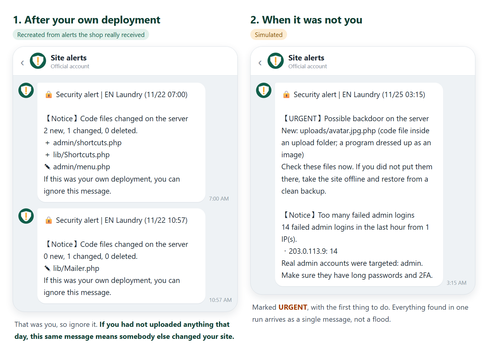

# LINE Security Alerts — サイトに異常があったら LINE でお知らせ

[繁體中文](README.md) | [English](README.en.md) | 日本語

> この日本語版は翻訳です。誤りがあれば Issue でお知らせください。

小さな PHP サイト（ネットショップ、予約サイト、自作の CMS など）向けの**侵入アラート**です。
ふだんは何も言いません。おかしなことが起きたときだけ、毎日見ている LINE に 1 通届き、
何が起きたのか、まず何をすればいいのかを伝えます。

もともとは台湾のクリーニング店 **沂恩精緻洗衣（EN Laundry）** のサイトのために作ったものです。
小さなお店にセキュリティ担当はいませんし、店主がサーバーのログを見ることもありません。でも LINE は毎日見ています。
実際に使ってみて役に立ったので、どのサイトでも使える形にまとめて公開しました。

> **通知の文面について**：届くメッセージは今のところ英語か繁体字中国語です（設定の `language`）。
> 日本語の文面にはまだ対応していません。このページの例も、英語で届いたときの形で載せています。

## 実際の例



**左は、沂恩精緻洗衣がある日に実際に受け取った通知の再現です**（ファイル名と件数は一般的な書き方に変えています）。

- 前の晩に管理画面の新機能をアップロードしたら、翌朝 7:00 の定期チェックで「どのファイルが新しく、どれが変更されたか」が届きました。
- 午前中にもう 1 本プログラムを更新したので、次のチェックでもう 1 通届きました。（ファイルをチェックする間隔は自分で決められます。初期設定は 1 時間ごとで、いつでも手動で実行できます。）

どちらも自分たちの作業なので、ちらっと見て閉じれば終わりです。**でも、そこが大事なところです**：サイトのプログラムが変わるたびに、必ずわかります。
何もアップロードしていない日に同じメッセージが届いたら、それは誰か別の人がサイトを触ったということです。しかもそれが、数か月後ではなくその日のうちにわかります。

**右は「自分たちではない」場合のシミュレーションです**：アップロード用フォルダに画像のふりをしたプログラムが現れ、同時に誰かが管理画面のパスワードを当てようとしています。
メッセージには「URGENT（緊急）」の印が付き、1 回のチェックで見つかったことは 1 通にまとめて届き、最初にやるべきことも書いてあります。

自分で再生してみることもできます（LINE アカウント不要、ネットにもつながず、本物のサイトにも触りません）：

```
php skills/line-security-alerts/scripts/demo.php --site="My Shop"
```

画像のメッセージはどれも、このデモが実際に出力した文面です。別に書いた宣伝文ではありません。
（`--lang=zh-TW` を付けると繁体字中国語の文面になります。）

**何もないときは？** 完全に静かです。届くのは週に 1 通の動作報告だけ。届かない週があれば、チェックが止まっているとわかります：

```
✅ Weekly check-in | EN Laundry (11/28 09:05)

Still on duty. Last 7 day(s): 2016 checks run, 4 thing(s) reported (1 urgent).
Watching 1850 code files; last full scan 11/28 07:00.
Code fingerprint: 3f9a-0c1d-77b2-e4a8. It comes with every check-in from now on; scroll up to compare with the one before.
LINE messages this month: about 37 of 200 used.
Channels checked without sending a message: LINE OK.
Records go back to 2026-11-20. If that date is newer than you remember, the records were reset: ask why.
You get this once a week. If a week passes without it, the checks have stopped running.
```

「LINE messages this month」の行は、週に一度ついでに LINE に問い合わせたものです。LINE公式アカウントが月に送れるメッセージ数には上限があり、使い切ると届かなくなります。
8 割を超えると警告になるので、プランを上げるか、予備のメール（または Telegram・Discord）が設定されているか確認する余裕があります。
LINE が予備にすぎず（ふだんは Telegram や Discord に届く）、その週に一度も使われなかった場合、この行は出ません。

通知を受け取ったあとどうするかは、店主向けの説明にまとめてあります：
**[通知が届いたら](skills/line-security-alerts/reference/when-an-alert-arrives.ja.md)**（スマホに保存しておくのがおすすめです）。

### 「Code fingerprint（コード指紋）」とは

サイトにあるすべてのプログラムファイルの中身から計算した、短い文字列です。どれか 1 本でも変更・追加・削除されると、この文字列が変わります。

ポイントは、**この文字列はサーバーではなく、あなたの LINE のトーク履歴に残る**ことです。サーバーに侵入した人は、プログラムだけでなく監視の記録まで書き換えて「何もなかったように」見せられるかもしれません。
でも、あなたのスマホにある先週のメッセージは書き換えられません。

自分で見比べる必要はありません。メッセージに結論が書いてあります：

| メッセージの内容 | 意味 |
|---|---|
| same as the last check-in | この 1 週間、プログラムは変わっていません |
| was xxxx; N code-change notice(s) were sent in between | 変わっていて、通知も届いています。それが全部自分たちのアップロードなら問題ありません |
| was xxxx; N change(s) were written to the log but not sent | サイトが自分で書き換えるファイルか、その日の通知が上限に達したためです。開発者に記録を見てもらってください |
| ⚠ it changed, yet no code change is on record | 監視の記録が書き換えられた可能性があります。「バックドアがあるかもしれない」ときと同じ対応をしてください |

自分で確かめたいときは、ひとつ前の動作報告までさかのぼって、2 つの文字列を見比べてください。
開発者は、手元にあるきれいな元ファイルから同じ文字列を計算して、LINE のものと比べることもできます（方法は
[integration.md の 10 節](skills/line-security-alerts/reference/integration.md)、英語）。同じなら、サーバー上のプログラムはアップロードしたものとまったく同じです。

### スケジュールが止まったら：外部チェックイン

週 1 回の動作報告には弱点があります。定期実行（cron）が壊れても、「今週は届かなかった」と気づくまでわかりません。もっと早く知りたいなら、
healthchecks.io のような「cron のチェックイン」サービス（無料プランあり）が使えます。サービスが発行する URL を設定の `ping_url` に入れると、
チェックが 1 回終わるたびにその URL へ報告します。決めた時間（5 分ごと、猶予 10 分がおすすめ）を過ぎても報告がなければ、そのサービスがメールなど選んだ方法で知らせてくれます。

これは任意です。設定しなければ外部には接続しません。報告に失敗してもチェックには影響せず、URL が記録やメッセージに書かれることもありません。
URL が間違っていて失敗が続くと、週 1 回の動作報告に警告の行が 1 行増えます。

## 何を知らせるか

| 分類 | 知らせるとき | レベル |
|---|---|---|
| 管理画面のログイン | 1 時間のログイン失敗が多すぎる（全体または 1 つの IP から）。あるアカウントが「使ったことのないブラウザ＋使ったことのないネットワーク」からログインに成功した | Notice（大量なら URGENT） |
| 管理者アカウント | アカウントの追加・削除、役割や権限の変更、メールアドレス・パスワードの変更、2 段階認証の無効化、パスキーの追加 | URGENT／Notice |
| サーバーのファイル | 新しいプログラムファイル、プログラムの変更・削除、アップロード用フォルダにプログラム、Web シェル（バックドア）らしい中身、変更したうえで更新日時を元に戻したもの | URGENT／Notice |
| ファイアウォール | 1 時間にブロックした回数が多すぎる（全体または 1 つの IP から） | Notice |
| お金 | 1 時間に手動の返金、支払い済み注文のキャンセル、残高の手動調整が多い、または 1 件の金額が特に大きい | Notice |
| ページの中身（任意） | ページがほかのサイトのプログラムを読み込み始めた、フォームの送信先がほかのサイトになった、訪問者がよそへ転送される。Google にだけ見せているスパムリンク。新しい外部リンク | URGENT／Notice |
| 緊急ブレーキ（任意） | 通知のブレーキのリンクが押され、管理画面がロックされた。コマンドで解除された | URGENT／Notice |
| 独自 | 自分で追加したチェック（バックアップ失敗など） | 自由に決める |
| 監視そのもの | 指紋の記録が消された、記録フォルダが空にされた、基準が手動でリセットされた——監視を無効にしようとする動き自体を知らせます | URGENT／Notice |
| 週 1 回の動作報告 | 「まだ動いています」の 1 通。その週のチェック回数・報告件数と、先週と比べられるコード指紋付き | （アラートではありません） |
| スケジュール停止（任意） | チェックのたびに外部サービスへ報告。止まれば数分で外部サービスが知らせます | 外部サービスから届きます |

設計の考え方：

- **何もなければ静か**：同じことは 6 時間に 1 回だけ。1 日の上限は `daily_cap` 通（URGENT は上限なし）。
  初回の実行は今の状態を記録するだけで、通知は送りません。
- **サイトを遅くしない**：サイトのプログラムは「ログを 1 行書く」だけで、お客さんのリクエストの中で LINE を呼ぶことはありません。
  チェックと送信は定期実行（5 分ごと）が行います。
- **1 つのチャネルがだめなら次へ**：LINE が送れない（たとえば無料プランの月間通数を使い切った）ときは Telegram、Discord、メールに切り替えます。
  どれも送れないときは通知を保管しておき、送れるようになったら「何時の通知か」を明記して後から送ります。サーバーのログに埋もれたままにはなりません。
- **ファイルは 1 時間ごとに比較し、週に 1 回は全ファイルを読み直す**。ふだんはサイズか日時が変わったファイルだけを読み直します（軽い）。
  週 1 回はサイズも日時も関係なく全部計算し直すので、「変更して日時を戻し、長さも同じ」という手口も見逃しません。
- **PHP ファイル 1 本、データベースのテーブルは作らない**：データは指定したフォルダに保存。PHP 7.4〜8.x で動き、フレームワークにも依存しません。

これは**ファイアウォールではありません**。誰かをブロックしたり、自動で直したりはしませんし、バックアップ・アップデート・強いパスワードの代わりにもなりません。役目は「いち早く知らせること」です。
初期設定では知らせるだけで、サイトのファイルには一切触りません。唯一の例外が、自分でオンにする下の「自動隔離」です。

### 自動隔離（任意・初期設定はオフ）

`'quarantine_uploads' => true` にすると、**アップロード用フォルダに新しく現れたプログラムファイル**はすぐに名前が変えられ、サーバーがプログラムとして実行しなくなります。
たとえば `uploads/avatar.jpg.php` は、同じフォルダの `avatar_jpg_php-20261125-031500.quarantined` になり、通知には新旧のファイル名が書かれます。

わざと小さく作ってあります：

- **名前を変えるだけで、削除しません**。そのファイルは、相手がどうやって入ってきたかを調べる証拠です。
- **アップロード用フォルダに「新しく現れた」プログラムだけ**が対象です。ほかの場所のファイル、もともとあったファイル、`.htaccess` のような設定ファイルには触らず、知らせるだけです。
- **元に戻すには、名前を戻すだけ**です。
- 名前の変更に失敗した（権限がない）ときは、「そのファイルはまだ実行できる」と通知にはっきり書かれます。

オンにする前に 2 つ確認してください。`upload_dirs` に入れたのが本当に「画像や文書だけを置くフォルダ」であること。
そして、隔離をオフにしていた間に「自分たちがアップロード用フォルダに置いたプログラム」の通知が来ていないこと。来ていたら、そのフォルダを外してからオンにしてください。

これは減速帯であって、防壁ではありません。チェックには間隔があり（初期設定 1 時間、最短で定期実行ごと）、その前に相手がファイルを使ってしまったかもしれません。
通知を受け取ったあとにやること（パスワードの変更、侵入経路の調査）は、同じようにすべて必要です。

もう 1 つ、先にお伝えしておくべき限界があります。このモジュールはサイトと同じサーバーで、同じユーザーとして動いています。侵入した人がサイトと同じ権限を持っていれば、
理論上は監視そのものを書き換えられます。だからこそ、サーバーの「外」に置くもの——LINE に届く 1 通 1 通と毎週のコード指紋、外部チェックイン——があり、痕跡を残さずに済ませるのを難しくしています。

### ページに何か仕込まれたら：ページ監視（任意）

小さなサイトの侵入では、サーバーのプログラムが 1 つも変わらないことがよくあります。変えられるのは**データベースの中身**で、ファイルの比較では見えません：

- **ギャンブルやアダルトのスパムリンク**：記事やフッターの設定に仕込まれ、しかも Google のクローラーにだけ見せることが多い。自分で開くと普通に見えるので、検索結果にカジノのタイトルが出て初めて気づきます。
- **カード情報の盗み取り**：フッターの設定などにほかのサイトのプログラムを追加し、お客さんが決済画面で入力した内容をよそへ送ります。
- **Google から来たお客さんだけ転送**：検索結果から来た人だけがよそのサイトへ転送されるので、自分でアドレスを打って開いても気づけません。

見張るページをいくつか指定します：

```php
'page_watch' => array('https://example.com/', 'https://example.com/cart'),
```

定期実行が 1 時間ごとに、4 つの立場でページを読みます。パソコンのブラウザ、スマホ、Google のクローラー、Google 検索から来たスマホです。
ページごとに使っている**ほかのサイト**（読み込むプログラム、埋め込み、フォームの送信先、転送、外部リンク）を記録し、前回と比べます：

| 見つかったもの | レベル |
|---|---|
| クローラーか Google から来た人にだけ出るリンク・プログラム・転送 | URGENT |
| プログラム、埋め込み、フォームの送信先、転送に新しい外部サイト | URGENT |
| 誰にでも見える新しい外部リンク | Notice |

最初の読み込みは今の状態を記録するだけです。設定したら一度 `--pages` を実行してください。各ページが今使っている外部サイトを一覧にし、
「検索エンジンにだけ見えるもの」に印を付けます。怪しいものがないことを確かめてから、それを基準にしてください。

知っておいてほしいこと：

- 中身が**あまり変わらない**ページ（トップ、商品ページ 1 つ、カート）を選んでください。毎日新しい記事へのリンクが増える一覧ページは向きません。
- 自分でチャット、決済、アクセス解析のサービスを追加すると、一度通知が来ます。自分のものなら、そのドメインを `page_allow` に入れれば次からは知らせません。
- メッセージのドメインが `example[.]com` と書かれているのはわざとです。チャットアプリはドメインをタップできるリンクにしてしまい、それが攻撃者のサイトかもしれないからです。
- 動くのは定期実行（コマンドライン）の中だけで、お客さんがページを開いている最中に自分のサイトを読みにいくことはありません。
- サーバーの中から Google のクローラーのふりをするので、限界があります。Google の本物の IP アドレスかどうかを確かめてからスパムを出す手口は見抜けません。
  そこは Google Search Console の「セキュリティの問題」レポートで補ってください。
- サイトの前のファイアウォールが「偽の Google クローラー」をブロックする設定だと、クローラーとしての読み込みは失敗し続けます。`--status` がそう表示し、残りの 3 つは通常どおり比較します。

### 更新をアップロードする前に予告する（--expect）

アップロードのたびに通知が来ると、だんだん読まなくなり、本当に大事な 1 通も一緒に流してしまいます。アップロードの前に実行します：

```
php security-alerts-cron.php --expect 30m
```

まずすべてのチェックを 1 回実行します（それより前の変更はいつもどおり通知）。そのあと 30 分間、ふつうのプログラムの変更は 1 つずつ通知せず、
時間が来たら**1 通にまとめて**送ります（英語の文面では「Code changes during your announced update: 3 new, 12 changed, 1 deleted」とファイル名）。
早く終わったら `--expect off` で、すぐにその 1 通が届きます。

予告を隠れみのには使えません：

- バックドアらしい中身、アップロード用フォルダのプログラム、変更して日時を戻したファイルは、予告中でも**すぐに URGENT で通知**します。
- 予告は最長 4 時間です。誰かがサーバーでこっそり「2099 年まで予告」と書き込んでも、4 時間後にはまとめの 1 通が届き、変えたファイルが並びます。
- まとめの最後には「その時間に誰も更新していなければ、侵入として扱ってください」と書かれています。

自動デプロイなら、`--expect 20m` をデプロイの最初に、`--expect off` を最後に入れておけます。

### 緊急ブレーキ（任意）

夜中に URGENT が届いたのに開発者に連絡がつかない。プログラムがわからない店主に何ができるでしょうか。設定すると、URGENT の通知の最後に 1 行加わります（英語の文面の例）：

```
🛑 Not your doing, and nobody to call? Lock the admin area for 4 hours (the shop stays open): https://example.com/security-brake.php?t=…
```

リンクを開くと説明とボタンのページが出るだけです（LINE はプレビューを作るためにリンクを開くので、「開いただけ」でロックされては困ります）。
**ボタンを押すと**、管理画面が 4 時間ロックされます。その間は、すでにログインしている人も含めて誰も管理画面を使えません。お客さんはいつもどおり買い物できます。
次のチェックで「The admin area is locked」が届き、押された時刻と IP が書かれます。

- リンクには署名があり、1 回しか使えず、24 時間で期限が切れます。書き換えたリンクには「Not found」としか表示されません。
- Web 側からは**ロックしかできません**。解除はサーバーで `--unlock`、または時間切れを待ちます。
- 最悪の場合、通知を読める誰かが押すと、管理画面が数時間ロックされ、すぐにそれが通知されます。
- 開発者にしてもらうのは 3 つです：`examples/security-brake.php` をサイトに置く、`brake_url` と 32 文字以上の `brake_secret` を設定する、
  管理画面のすべてのページの最初に `adminLocked()` のチェックを 1 行入れる（[integration.md の 16 節](skills/line-security-alerts/reference/integration.md)）。このチェックがないと、押してもロックされません。

## ほかのツールとの組み合わせ

このパッケージが向いているのは、**レンタルサーバーで root 権限がなく、サイトは自作かカスタマイズした PHP、店主は毎日 LINE を見ている**場合です。
ほかのツールのほうが得意なこともあるので、組み合わせて使えます：

| 状況 | おすすめ |
|---|---|
| サイトが WordPress | Wordfence や Sucuri などのセキュリティプラグインを入れてください。WordPress の各ファイルが「本来どうあるべきか」を知っていて、専門チームが更新するマルウェアの特徴も持っています。この 2 つは私たちにはありません。このパッケージは併用でき、LINE 通知を補えます |
| 攻撃を外で止めたい | サイトの前に Cloudflare のようなサービスを置いてください。止めるのはサーバーの外で。このパッケージは知らせるだけで、ブロックはしません |
| レンタルサーバー会社がウイルススキャン（Imunify360、maldet など）を提供している | 有効にしてもらってください。サーバー全体をスキャンでき、隔離もできます。私たちが見るのはサイトのフォルダにあるプログラムだけです |
| 自分でサーバーを管理している（VPS、root 権限あり） | Wazuh や AIDE（ファイル改ざん検知。基準を別のマシンに置ける。Wazuh はリアルタイム監視も可能）、fail2ban や CrowdSec（自動ブロック）が使えます。レンタルサーバーには入れられません |
| 「定期実行はまだ動いているか」を知りたい | healthchecks.io のような cron チェックインサービス。URL をこのパッケージの `ping_url` に |
| 「サイトが開けるか」を知りたい | UptimeRobot のように外から定期的にサイトを開くサービス。このパッケージはサーバーの中で動くので、サーバーごと止まると通知も送れません |
| 「Google にハッキングされたと思われていないか」を知りたい | Google Search Console の「セキュリティの問題」。Google の本物のクローラーが見た内容なので、ページ監視がサーバーの中からは引き出せない手口も含みます |

### 日本の法令・ガイドラインとの関係（参考）

法的な助言ではありません。2026 年 11 月時点で公式の資料を確認した内容です。最新の内容は、それぞれのリンク先で確かめてください。

- **IPA「ECサイト構築・運用セキュリティガイドライン」**（2023 年 3 月）は、運用時の要件 3 を「必須」としています：
  「Web サイトのアプリケーションやコンテンツ、設定等の重要なファイルの定期的な差分チェックや、Web サイト改ざん検知ツールによる監視を行う。」
  このパッケージのファイルの比較（と任意のページ監視）は、その 1 つのやり方です。
  [IPA のページ](https://www.ipa.go.jp/security/guide/vuln/guideforecsite.html)
- **クレジットカード・セキュリティガイドライン【6.1版】**（2026 年 3 月）は、EC 加盟店に 2025 年 4 月から「脆弱性対策」を求めています（カード情報を保持するかどうかにかかわらず）。5 つの対策のうち、このパッケージが**補助できる**のは一部だけです：
  - 「システム管理画面のアクセス制限と管理者の ID/パスワード管理」：ログイン失敗の多発、見慣れない端末からのログイン、管理者アカウントの変更を知らせます。ただし、アクセス制限・2 段階認証・アカウントロックそのものはサイト側で行う必要があります（[予防チェックリスト](skills/line-security-alerts/reference/hardening-checklist.ja.md)）。
  - 「データディレクトリの露見に伴う設定不備への対策」：アップロード用フォルダにプログラムが現れたら知らせます。拡張子の制限などの対策そのものではありません。
  - 「Web アプリケーションの脆弱性対策」「マルウェア対策としてのウイルス対策ソフトの導入、運用」「悪質な有効性確認、クレジットマスターへの対策」：このパッケージは代わりになりません。
  - このガイドライン自体は改ざん検知を必須にしてはいませんが、「スクリプトコンテンツ改ざん等」による情報の漏えいが続くケースに触れています。
  [クレジット取引セキュリティ対策協議会の資料ページ](https://www.j-credit.or.jp/security/document/index.html)
- **個人情報保護法の漏えい等報告**：たとえば不正アクセスによる漏えい（またはそのおそれ）、クレジットカード番号を含む漏えいは、個人情報保護委員会への報告と本人への通知の対象です。
  速報は知ってから「概ね 3～5 日以内」、確報は 30 日以内（不正の目的によるおそれがある場合は 60 日以内）。入力ページが改ざんされて入力内容が第三者に送られたケースも例に挙がっています。
  2026 年 7 月に改正法が公布され（施行は公布から 2 年以内）、本人への通知などが変わる予定です。
  [個人情報保護委員会：漏えい等の対応](https://www.ppc.go.jp/personalinfo/legal/leakAction/)

このパッケージがあれば何かの基準を満たす、ということではありません。「起きたことに早く気づく」部分を手伝うものです。

このパッケージは **LINE Messaging API** を使っています。以前よく使われていた LINE Notify は 2025 年 3 月 31 日にサービスを終了しました。

このパッケージの役目は「何か起きたら知らせる」ことです。起きる前にできること（アップロード用フォルダでプログラムを実行させない、管理画面の前にもう 1 枚扉を付ける…）は
**[予防チェックリスト](skills/line-security-alerts/reference/hardening-checklist.ja.md)** にまとめました。いくつかは読者からの提案です。

## インストール

### 方法 A：Claude Code で Claude にインストールしてもらう（おすすめ）

```
/plugin marketplace add brain113tw/line-security-alerts
/plugin install line-security-alerts@line-security-tools
```

そのあと、サイトのプロジェクトで Claude に「サイトに LINE のセキュリティ通知を付けて」と頼んでください。
Claude はまずログイン、アカウント管理、アップロード用フォルダなどの場所を探してあなたに確認し、それから通知をつなぎます。
付属の偽 LINE サーバーで試したうえで、最後に本物のテストメッセージを送ってよいか尋ねます。

**確認済みの決まったバージョンを入れたい場合**（セキュリティツールにはおすすめです）は、リリースのタグを付けます：

```
/plugin marketplace add brain113tw/line-security-alerts#v1.4.0
/plugin install line-security-alerts@line-security-tools
```

こうすると、知らないうちにコードが変わることはありません（サードパーティのマーケットプレイスは、もともと初期設定で自動更新されません）。
更新するときは [CHANGELOG.md](CHANGELOG.md) を読んでから、マーケットプレイスを削除し、新しいタグで追加し直します。
1.3.0 からは、GitHub の Releases ページに各リリースの `lib/SecurityAlerts.php` の SHA-256 を載せるので、手元のファイルと比べられます（`sha256sum` か `php skills/line-security-alerts/scripts/fingerprint.php`）。

### 方法 B：skill だけコピーする

`skills/line-security-alerts/` フォルダを丸ごと `~/.claude/skills/`（すべてのプロジェクトで使える）か、
プロジェクトの `.claude/skills/` にコピーします。

### 方法 C：Claude を使わず自分でつなぐ

```php
require 'lib/SecurityAlerts.php';
$alerts = new SecurityAlerts(require '/公開フォルダの外/security-alerts.config.php');

// ログインの失敗／成功
$alerts->loginFailed($user, $ip, $_SERVER['HTTP_USER_AGENT'] ?? '', $userExists);
$alerts->loginSucceeded($user, $ip, $_SERVER['HTTP_USER_AGENT'] ?? '');

// 管理者アカウントの変更、ファイアウォール、お金
$alerts->accountChanged('role', $targetUser, $operator, 'editor -> admin');
$alerts->firewallBlocked($ip, 'sqli', $_SERVER['REQUEST_URI']);
$alerts->moneyEvent('refund', 1200, $operator, $orderNo);
```

定期実行は 5 分ごと：

```
*/5 * * * *  /usr/bin/php /path/to/security-alerts-cron.php >> /path/to/security-alerts-cron.log 2>&1
```

インストールして最初に実行したら、一度これを実行してください：

```
php security-alerts-cron.php --audit
```

初回の実行は「今のサーバーの状態」を正常として記録します。インストール前にすでにバックドアが置かれていたら、それも正常として扱われてしまいます。
`--audit` はすべてのプログラムファイルを読み、中身が怪しいものやアップロード用フォルダにあるプログラムを一覧にするので、あなた（か開発者）が 1 つずつ確認できます。
正常なプログラムが載ることもあるので、一覧を出すだけで、通知も送らず、ファイルにも触りません。

あとで「ちゃんと動いているか」を知りたいときは、これを実行します：

```
php security-alerts-cron.php --status
```

前回のチェック時刻、見ているファイル数、最近の報告、送れずに残っている通知を表示し、対応が必要なことは最後に `!!` で示します。
こちらも見るだけで、メッセージは送りません（通知用のLINE公式アカウントの友だち数だけは LINE に問い合わせます）。

更新をアップロードする前は `--expect 30m`（上の「予告」を参照）。ページ監視を設定したら、一度 `--pages` を実行してください。

フックをどこに置くか、ファイルスキャンの設定は
[skills/line-security-alerts/reference/integration.md](skills/line-security-alerts/reference/integration.md)（英語）を、
通知が届いたときの対応は [通知が届いたら](skills/line-security-alerts/reference/when-an-alert-arrives.ja.md) を見てください。

## LINE で用意するもの

1. **通知専用のLINE公式アカウント**を作ります。お客さんが友だち追加しているアカウントは使わないでください。
   理由：トークンはサイトのサーバーに置くので、侵入されれば相手の手にも渡ります。お客さん向けのアカウントだと、すべてのお客さんにメッセージを送られてしまいます（偽の「決済に失敗しました、こちらをタップ」など）。
   通知専用なら友だちは自分と数人のスタッフだけで、トークンを盗まれても被害はわずかです。
   `--status`、`--test-all`、週 1 回の動作報告は、このアカウントの友だち数のおおよそを LINE に問い合わせ、20 人を超えると警告します。
   LINE Official Account Manager の「設定」→「Messaging API」→「Messaging APIを利用する」で有効にします。
   途中でプロバイダーを作成します。プロバイダーは後から変更できません。
2. LINE Developers コンソールでそのチャネルを開き、［Messaging API設定］タブから**長期のチャネルアクセストークン**を発行します。
3. ［チャネル基本設定］タブの**あなたのユーザーID**（U で始まる）が送り先です。スマホでこのLINE公式アカウントを友だち追加しておきます。
4. `php security-alerts-cron.php --test` を実行し、スマホに届けば完了です。

詳しい手順とエラーコードの一覧：[reference/line-setup.md](skills/line-security-alerts/reference/line-setup.md)（英語）。

## Telegram や Discord も使えます

LINE公式アカウントで無料で送れる通数には限りがあり、日本の無料プラン（コミュニケーションプラン）は月 200 通までです。それ以上は有料プランが必要です。
そこで Telegram と Discord も組み込んであります。どちらも無料です。どれか 1 つだけでも、全部設定してお互いの予備にしてもかまいません。

| | LINE | Telegram | Discord |
|---|---|---|---|
| 費用 | 無料プランは月 200 通まで。それ以上は有料プラン（日本：ライトプラン月 5,000 円・税別で 5,000 通 など） | 無料 | 無料 |
| 設定の手間 | 中：公式アカウントの作成、Messaging API の有効化、トークンとユーザー ID の取得 | 少：公式ボット `@BotFather` からトークンをもらい、チャット ID を調べる | 少：サーバー設定でウェブフックを作り、URL をコピー |
| すぐ気づけるか | 日本でも多くの人が一日中 LINE を開いていて、いちばん気づきやすい | スマホにアプリを入れ、通知をオンにしておく必要あり | スマホにアプリを入れ、このチャンネルの通知を「すべて」にしておく必要あり（多くのサーバーは初期設定でメンションだけ通知） |
| キーが漏れたら | このLINE公式アカウントから、友だち追加した**全員**にメッセージを送られる。通数も消費される。だから通知専用のアカウントにする | このボットを完全に操作される：ボットとして送信、ボットに届いたメッセージの受信 | そのチャンネルに何でも投稿される。ウェブフックを削除されることもある（削除されると通知は自動で次のチャネルへ） |

どれを使う場合も、キーは LINE のトークンと同じように扱ってください。環境変数に置き、バージョン管理に入れず、スクリーンショットも共有しないこと。

### Telegram の設定

1. Telegram で `@BotFather`（青いチェックマークの公式アカウント）を探し、`/newbot` を送って質問に答え、名前を付けます。
   最後に `123456789:AAH…` のようなトークンがもらえるので、`telegram_bot_token` に入れます。
2. スマホで作ったボットを開き、「START」を押します。グループに送りたい場合は、ボットをグループに追加します。
   トピックのあるグループで特定のトピックに送りたい場合は、そのトピックで `/start@ボットのユーザー名` を送ります。
3. `php security-alerts-cron.php --telegram-chats` を実行します。最近ボットに話しかけた人・グループ・トピックが一覧で出るので、
   通知を受け取るものの ID を `telegram_chat_id` に入れます（グループはマイナスの数字、トピックは `-1001234567890/12` の形）。
   このコマンドは読むだけで、何も送らず、既読にもしません。
4. `php security-alerts-cron.php --test-all` を実行し、スマホに届けば完了です。

Telegram では、見出しが太字になり、「どうするか」の部分はタップすると開く枠にたたまれ、メッセージの下にボタンが付きます：
どの通知にも「📖 What to do」、URGENT には（緊急ブレーキを設定していれば）「🛑 Lock the admin area for 4 hours」。
Telegram がこの書式を受け付けなかった場合は、すぐにプレーンテキストで送り直すので、書式のせいで通知が届かないことはありません。
グループがスーパーグループに変わって ID が変わったときは、自動で新しい ID に送り、`--status` が設定の書き換えを促します。

### Discord の設定

1. 「サーバー設定」を開き、「連携サービス」タブで「ウェブフックを作成」を押します。通知を受け取るテキストチャンネルをドロップダウンで選び、「ウェブフックURLをコピー」を押します。
   ウェブフックを管理できる権限が必要です（自分で作ったサーバーなら持っています）。
2. URL を `discord_webhook_url` に入れます。特定のスレッドや、フォーラムチャンネルの特定の投稿に送りたい場合（フォーラムチャンネルでは必須）は、
   URL の後ろに `?thread_id=<ID>` を付けます（「詳細設定」で開発者モードをオンにし、スレッドを右クリック →「スレッドIDをコピー」）。
3. スマホの Discord でこのチャンネル名を長押しし、「通知設定」で「すべて」を選びます。
4. `php security-alerts-cron.php --test-all` を実行します。

Discord では 1 件ごとに 1 枚のカードになります：URGENT は赤、Notice はオレンジ、動作報告は緑です。
中身はコードブロックに入るので、ファイル名のアンダースコアやアスタリスクが太字や下線にならず、
アカウント名に `@everyone` や偽のリンクが書かれていても、サーバー全員に通知が飛んだり、クリックできるリンクになったりしません。
「どうするか」は別の欄に、ブレーキと説明のリンクは最後のカードに入ります。
Discord が「このウェブフックは存在しない（削除された）」と答えたら、以後は送ろうとしません（試し続けると Discord に一時的に制限されるため）。`--status` が新しいウェブフックを作るよう促します。

### 鳴るのは URGENT だけ

初期設定では、スマホが鳴るのは URGENT の通知だけです。Notice と週 1 回の動作報告もちゃんと届きますが、静かに届きます：
LINE は通知を出さず、Telegram は音なしで通知し、Discord は通知を出さず未読マークだけになります。
同僚がファイルをアップロードしただけで夜中に起こされることがなくなり、鳴ったときの 1 回が本気で受け止められます。

Notice も鳴らしたいなら `'ring_level' => 1`、動作報告も含めてすべて鳴らすなら `0` にします。
URGENT とテストメッセージは必ず鳴ります。メールには関係しません。

### 複数のチャネルを設定したとき

送るのは 1 か所だけです。**Telegram → Discord → LINE → メール**の順に試し、最初に送れたところで止まるので、同じ通知が二重に届くことはありません。
（自作の `notifier` があれば、それが最初に試されます。）

LINE の通数を本当に大事なことのために取っておきたいなら、1 行追加します：

```php
'line_min_level' => 2,
```

2 にすると、**URGENT の通知は LINE が最初**（LINE で送れなければほかのチャネルへ）、Notice と週 1 回の動作報告は Telegram、Discord、メールに送ります。
1 にすると、週 1 回の動作報告だけが LINE を使いません。
LINE 以外のチャネルが何も設定されていなければ、それでも LINE で送ります（届かないよりはまし）。そのときは `--status` が教えてくれます。

`--test-all` は設定したチャネルそれぞれにテストを 1 通ずつ送り、失敗したものには理由と直し方を表示します
（たとえば「HTTP 403: Forbidden: bot was blocked by the user」の次の行に、英語で「ボットを開いて Restart を押す」）。
`--test` は Notice と同じ経路で 1 通だけ送り、最終的にどのチャネルが受け取ったかを表示します。

**予備のチャネルもふだんから確認します**：予備が使われるのはメインのチャネルが失敗したときだけで、それは予備も壊れていたと知るのに最悪のタイミングです。
そこで送り先が 2 か所以上あるときは、週 1 回の動作報告のついでにすべてのチャネルがまだ使えるかを確かめ、
「Channels checked without sending a message: Telegram, Discord, LINE OK.」のように 1 行で報告します。
メッセージは送りません。Telegram では一瞬「入力中…」と表示されるだけで、Discord と LINE は問い合わせるだけです。
使えなくなったチャネル（ボットのブロック、ウェブフックの削除、LINE の送り先によるブロックなど）があれば動作報告が警告になり、`--status` が直し方を表示します。
これがいちばん必要なのは LINE です。ブロックした相手へのプッシュも LINE は「送信成功」と答えますが、実際には届きません。

**複数のサイト**：同じボットやチャンネルを共有できます。サイトごとに `site_name` を変えれば区別できます。分けたい場合は、
Telegram ならトピックのあるグループで、サイトごとに自分のトピック ID（`-1001234567890/12`、`-1001234567890/13`）を、
Discord ならサイトごとにスレッド（`?thread_id=`）かウェブフックを使います。

**ほかのチャネル（Slack、SMS など）**：設定の `notifier` に自作の送信処理をつなげます。最初に試され、
送れればほかは使いません。鳴らすべきかどうかも 3 つ目の引数で渡されます。書き方は設定テンプレートの最後にあります。

## 主な設定

| 設定 | 初期値 | 説明 |
|---|---|---|
| `state_dir` | （必須） | 記録と指紋の保存先。公開フォルダの外が理想 |
| `line_channel_access_token`、`line_to` | | LINE のトークンと送り先（環境変数に置き、バージョン管理に入れない） |
| `telegram_bot_token`、`telegram_chat_id` | | Telegram ボットのトークンとチャット ID（任意。`--telegram-chats` で ID が一覧に出る。トピックは `-100…/12`）。トークンは環境変数に |
| `discord_webhook_url` | | Discord チャンネルのウェブフック URL（任意。`?thread_id=` を付けるとスレッドへ）。URL そのものがキー |
| `line_min_level` | 0 | どの通知に LINE を使うか：0＝すべて、1＝週 1 回の動作報告には使わない、2＝URGENT だけ（しかも LINE が最初） |
| `ring_level` | 2 | どの通知でスマホが鳴るか：2＝URGENT だけ、1＝Notice も、0＝すべて（動作報告を含む）。鳴らないものも届く |
| `rich_messages` | オン | Telegram は太字とボタン、Discord は色付きのカード。オフ＝以前と同じくすべてプレーンテキスト |
| `guide_url` | `auto` | 「What to do」ボタンのリンク先：`auto`＝GitHub 上のこのパッケージの説明（`language` が `en` なら英語版。日本語版にしたいときは `reference/when-an-alert-arrives.ja.md` の URL を指定）、空＝ボタンなし、または自分の URL |
| `mail_to` | | すべてのチャネルが失敗したときの予備のメール |
| `language` | `en` | `en` または `zh-TW`（日本語の文面は未対応） |
| `site_root`、`exclude_dirs`、`upload_dirs`、`runtime_dirs` | | ファイルスキャンの範囲。キャッシュのフォルダは除外を忘れずに |
| `scan_hours` | 1 | ファイルを何時間ごとに比較するか。0＝定期実行のたび（5 分ごと）。読み直すのはサイズか日時が変わったファイルだけ |
| `rehash_days` | 7 | 何日ごとに全ファイルを読み直すか（0＝しない） |
| `input_charset` | | 古いサイトでファイル名やアカウント名が UTF-8 でない場合にその文字コード（例：Shift_JIS なら `CP932`、`EUC-JP`）を指定すると、メッセージで正しく表示されます。指定しなければ `?` と表示され、検知はそのまま動きます |
| `extra_rules`、`disable_rules` | | 自分で追加する怪しい特徴（前回の事件で見つかった文字列など）。自分のプログラムに誤反応する組み込みルールをオフに |
| `quarantine_uploads` | オフ | アップロード用フォルダに新しく現れたプログラムの名前を自動で変える（削除はしない）。上の「自動隔離」を参照 |
| `page_watch` | | 見張るページの URL（任意）。上の「ページ監視」を参照 |
| `page_allow` | | ページが意図して使っている外部サイト（例：`googletagmanager.com`、サブドメインを含む）。通知しない |
| `page_watch_hours` / `page_links` | 1 / オン | 何時間ごとにページを読むか／新しい外部リンクを通知するか |
| `line_friends_warn` | 20 | 通知を送るLINE公式アカウントの友だちがこの数を超えたら警告（0＝問い合わせない） |
| `brake_url`、`brake_secret` | | 緊急ブレーキ（任意）：ブレーキページの URL と 32 文字以上の秘密の文字列。上の「緊急ブレーキ」を参照 |
| `brake_hours` / `brake_link_hours` | 4 / 24 | 何時間ロックするか／リンクが何時間有効か |
| `brake_allow_ips` | | ロックの対象にしない IP（開発者の固定 IP など） |
| `quiet_hours` / `daily_cap` | 6 / 10 | 同じことを繰り返さない時間／1 日の上限通数 |
| `heartbeat_days` | 7 | 何日ごとに動作報告を送るか（0＝送らない） |
| `line_quota_check` | オン | 動作報告のついでに、今月 LINE で何通送ったか・上限は何通かを LINE に問い合わせる |
| `witness_file` | | 記録フォルダの「外」に置く小さなファイル。記録が丸ごと消されたときに気づくため |
| `ping_url` | | 外部の「cron チェックイン」サービスの URL（任意）。パスワードと同じように扱い、環境変数に |
| `notifier` | | 自作の通知チャネル（任意。Slack、SMS など）。最初に試される |
| `login_fail_hour` / `login_fail_ip_hour` | 10 / 5 | 1 時間に何回ログインに失敗したら知らせるか |
| `firewall_hour` / `firewall_ip_hour` | 50 / 20 | 1 時間に何回ブロックしたら知らせるか |
| `refund_*`、`cancel_*`、`adjust_*` | 回数 3〜5、金額 0（オフ） | 金額は自分の通貨に合わせて設定 |

全項目は `SecurityAlerts::defaults()` にあります。しきい値は出発点にすぎないので、1 週間ほど実際の様子を見てから調整してください。

## テスト（LINE アカウント不要）

```
php skills/line-security-alerts/scripts/selftest.php
```

311 のシナリオテスト（ログイン、端末、アカウント、ファイアウォール、お金、ファイル、バックドアの特徴、動作報告とコード指紋、記録の消去や改ざん、
古い指紋の移行、外部チェックイン、自動隔離、日時の巻き戻し、後送り、UTF-8 でないファイル名、1 日の上限、メールへの切り替え、
Telegram／Discord の送信順、長いメッセージの分割、「リクエストが多すぎる」ときの待機、予告、LINE の友だち数、
ページ監視の 4 つの読み方とクローラーにだけ見せるリンク、緊急ブレーキ、鳴る・鳴らない、Telegram の書式とボタン、Discord のカード、
グループの移行、削除されたウェブフック、チャネルの確認…）を、ネットにつながずに実行します。
更新のたびに、GitHub が Linux（PHP 7.4〜8.5）と Windows で自動的にもう一度実行します。

> **⚠️ ウイルス対策ソフトが警告を出すことがありますが、正常です**
>
> 「本当にバックドアを見つけられるか」を確かめるため、自己テストはシステムの一時フォルダ（名前は `lsa-selftest-…`）に
> **バックドアに似せたおとりファイル**をいくつか置きます。どれも 1 行だけで、実行されることはなく、テストが終われば自動で削除されます。
> Windows Defender などのウイルス対策ソフトがこれを見て「脅威が見つかりました」と表示し、ブロックや隔離をすることがあります。
>
> それはおとりがよくできているということで、**パソコンが感染したわけでも、このパッケージにマルウェアが入っているわけでもありません**。何もインストールされず、裏で動き続けるものもありません。
> おとりの中身はすべて `scripts/selftest.php`（`bait()` に渡している文字列）で読めます。
> ブロックされたおとりは飛ばされるだけで、ほかのテストには影響しません。
>
> また、`lib/SecurityAlerts.php` には照合用の「バックドアの特徴」の一覧が入っています。誤検知されないよう文字列を分割して書いてありますが、
> それでもサーバーのスキャナーが警告する場合は、このファイルをホワイトリストに入れてください。

実際に送られる内容を見たいときは、付属の偽 LINE サーバーを起動します：

```
php -S 127.0.0.1:18765 skills/line-security-alerts/scripts/fake_line_server.php
```

設定に `'line_api_base' => 'http://127.0.0.1:18765'` を加えると、送られたメッセージがそのターミナルに表示されます。
同じ偽サーバーは外部チェックインのサービスにもなれる（`'ping_url' => 'http://127.0.0.1:18765/ping/test'`）ので、どこにも登録せずに試せます。
Telegram と Discord のふりもでき、「リクエストが多すぎる」「サーバーエラー」「応答が遅い」「ボットのブロック」「グループの移行」「フォーラムチャンネル」といった状況も再現でき、
本物と同じように Telegram の書式やボタンの URL、Discord のカードの長さもチェックします（設定方法は `scripts/fake_line_server.php` の先頭にあります）。
偽のお店 `/shop/` もあり、`/shop/hack` を開くと「侵入された」状態（カード情報を盗むプログラム、クローラーにだけ見せるリンク、Google から来た人の転送）になるので、ページ監視を試せます。

## セキュリティとプライバシー

- キーは設定ファイルか環境変数にだけ置き、設定ファイルは公開フォルダに置かず、バージョン管理にも入れないでください。外部チェックインの URL（`ping_url`）も同じで、
  URL を知っている人はあなたのサイトになりすまして報告できます。Telegram のトークンは送信先 URL の一部になり、Discord のウェブフック URL はそれ自体がキーなので、
  これらの URL は記録にもエラーメッセージにも `--status` の出力にも書かれません。
- ファイルの指紋は SHA-256 です。管理者アカウントのスナップショットは、メールアドレス・パスワードハッシュ・権限の SHA-256 指紋だけを保存し、元の値は保存しません。
- LINE などに送るのは、アカウント名、IP、ファイル名、金額といった要約だけで、パスワードやお客さんの情報は含みません。
- 外部チェックインは中身のない接続を 1 回するだけで、サイト名やファイル名、通知の内容をそのサービスに送ることはありません。
- ページ監視が読むのは、あなたが指定した URL だけで、あなたのサーバーから読みます。読んだページはどこにも送らず、「どの外部サイトを使っているか」だけを記録フォルダに残します。
- テストは手元の環境かテスト用サイトで行い、本番サイトに攻撃を仕掛けて試さないでください。
- このパッケージ自体にセキュリティ上の問題を見つけた場合は、詳細を公開せず、[SECURITY.md](SECURITY.md) の方法で報告してください。

### この skill が Claude にさせること、させないこと

他人が書いた skill を入れるのは、それに Claude への指示を任せることなので、はっきり書いておきます。[SKILL.md](skills/line-security-alerts/SKILL.md) はただのテキストなので、自分で読めます。Claude への指示は：

- **すること**：サイトのプログラムを読んでログイン・アカウント・アップロードの場所を探し、まずあなたに確認する。`lib/SecurityAlerts.php` をプロジェクトにコピーし、その場所に 1 行ずつ足す。付属の偽サーバーで手元でテストする。本物のテストメッセージは**あなたの了承を得てから** 1 通だけ送る。
- **しないこと**：ネットからほかのプログラムをダウンロードしたり実行したりしない。キー、ユーザー ID、ウェブフック URL をメッセージ、ログ、バージョン管理、Claude 自身の返答に書かない。外部サービスに勝手に登録しない。本番サイトを攻撃してテストしない。ファイルの削除や IP のブロックを自分の判断でしない。サーバー設定や DNS を変えない。自動隔離や緊急ブレーキのような「動く」機能は、頼まれない限りオンにしない。
- このプラグインには hooks も MCP サーバーも、裏で動き続けるものもありません。入っているのは文書と PHP ファイルだけです。

バージョンごとの変更点は [CHANGELOG.md](CHANGELOG.md) にあります。

## ライセンス

MIT。自由に使い、改変し、共有してください。
