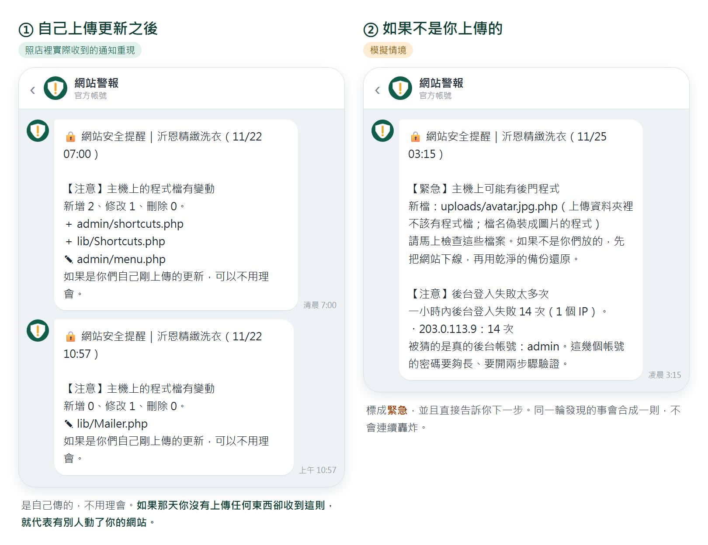

# LINE Security Alerts — 網站出事時，用 LINE 通知你

[English](README.en.md) | [日本語](README.ja.md)

給小型 PHP 網站（網路商店、預約網站、自架 CMS）的**入侵警報**：平常完全安靜，
看起來不對勁時，在你每天都在看的 LINE 上收到一則訊息，告訴你發生什麼事、下一步該做什麼。

這套做法最早是替台灣一家洗衣店 **沂恩精緻洗衣** 的網站做的。小店沒有資安人員，
老闆不會去看主機紀錄，但每天都在看 LINE。實際用下來覺得好用，所以整理成通用版分享出來。

## 實際案例



**左邊，照沂恩精緻洗衣某一天實際收到的通知重現**（檔名與數量改成通用寫法）：

- 前一晚上傳了一個後台新功能，隔天清晨 7:00 的定時檢查就列出「哪幾支是新的、哪幾支被改過」。
- 上午又更新了一支程式，下一次檢查時再收到一則。（多久檢查一次檔案可以自己設，預設每 1 小時；也可以隨時手動跑。）

兩則都是自己人做的，看一眼就可以滑掉。**但這正是它有用的地方**：網站的程式每被動一次，你都會知道。
哪天你明明沒有上傳任何東西，卻收到一模一樣的訊息——那就是有別人動了你的網站，而且你是在當天知道，不是幾個月後。

**右邊是模擬「不是你上傳的」會長怎樣**：上傳資料夾裡出現一支偽裝成圖片的程式，同時有人在猜後台密碼。
訊息會標成「緊急」，同一輪發現的事合成一則，並且直接告訴你第一步該做什麼。

想自己重播一次（不需要 LINE 帳號、不連網路、不碰真的網站）：

```
php skills/line-security-alerts/scripts/demo.php --lang=zh-TW --site="我的商店"
```

圖上的每一則訊息都是這支示範程式實際產生的文字，不是另外寫的文案。

**沒事的時候呢？** 完全安靜，只有每週一則報平安。哪一週沒收到，就知道檢查停了：

```
✅ 每週報平安｜沂恩精緻洗衣（11/28 09:05）

偵測持續運作中。過去 7 天：檢查 2016 次、回報 4 件事（其中緊急 1 件）。
目前看著 1850 支程式檔，上次完整檢查 11/28 07:00。
程式總指紋：3f9a-0c1d-77b2-e4a8。之後每週都會附上，往上滑就能跟前一則對照。
這個月 LINE 大約發了 37 則，上限 200 則。
通知管道正常：LINE（沒有發訊息，只確認連得上）。
紀錄從 2026-11-20 開始。這個日期如果比你記得的新，代表紀錄被重設過，要問清楚原因。
這則每週一次。哪一週沒收到，代表檢查沒在跑。
```

最後那一行「這個月 LINE 發了幾則」是每週順便問 LINE 的：官方帳號每個月能發的則數有上限，用完就發不出去。
用到八成會變成警告，讓你來得及升級方案或確認備援 Email 有設好。
如果 LINE 只是備援（平常走 Telegram 或 Discord），而且這段時間都沒用到，就不會出現這一行。

收到通知之後該怎麼做，有一份寫給老闆看的中文說明：
**[收到通知該怎麼辦](skills/line-security-alerts/reference/when-an-alert-arrives.zh-TW.md)**（建議存在手機裡）。

### 那串「程式總指紋」是什麼

把網站上每一支程式檔的內容算成一串字。只要有任何一支程式被改、被加、被刪，這串字就會變。

它的用處是：**這串字留在你的 LINE 聊天紀錄裡，不在主機上。** 有人闖進主機，可以改程式、也可以把偵測的紀錄一起改掉，
讓偵測「看起來沒事」；但他改不到你手機裡上週那一則訊息。

平常不用自己比，訊息會直接寫結論：

| 訊息寫 | 意思 |
|---|---|
| 跟上次報平安一樣 | 這一週程式沒被動過 |
| 上次是 xxxx，這段時間通知過 N 次程式變動 | 指紋變了，而且你收過通知。那幾次都是自己人上傳的就沒事 |
| 上次是 xxxx，有 N 次變動只寫進紀錄、沒有發通知 | 網站自己改寫的檔案，或當天通知已達上限。請工程師看一下紀錄 |
| ⚠ 指紋變了，但沒有任何程式變動的紀錄 | 偵測的紀錄可能被人改過。照「主機上可能有後門」處理 |

想自己確認，就往上滑到前一則報平安，兩串字對一下。
工程師還可以拿本機那份乾淨的原始檔算同一串字，跟 LINE 上的比（做法見
[integration.md 第 10 節](skills/line-security-alerts/reference/integration.md)）：一樣，就代表主機上的程式跟你上傳的一模一樣。

### 排程停了怎麼辦：外部報到

每週報平安有個弱點：排程壞掉，要等到「這週沒收到」才會發現。想更快知道，可以用 healthchecks.io 這類
「排程報到」服務（有免費方案）：它給你一個網址，把網址填進設定的 `ping_url`，偵測每跑完一次就去那個網址報到一次；
超過你設定的時間沒報到（建議設成每 5 分鐘一次、寬限 10 分鐘），那個服務就會寄信或用你選的方式通知你。

這是選用的，沒填就不會連出去。報到失敗不會影響偵測；報到網址不會寫進任何紀錄或訊息。
如果網址填錯、一直報到失敗，每週報平安會多一行警告。

## 會通知什麼

| 類別 | 什麼時候通知 | 等級 |
|---|---|---|
| 後台登入 | 一小時內失敗太多次（總數或單一 IP）；某帳號從「沒用過的瀏覽器＋沒用過的網路」登入成功 | 注意（大量時緊急） |
| 後台帳號 | 新增／刪除帳號、改角色或權限、改 Email／密碼、關掉兩步驟驗證、新增通行金鑰 | 緊急／注意 |
| 主機檔案 | 出現新的程式檔、程式檔被改或被刪、上傳資料夾裡出現程式檔、內容像後門（web shell）、改完還把修改時間調回去 | 緊急／注意 |
| 防火牆 | 一小時內擋下太多次（總數或單一 IP） | 注意 |
| 金額 | 一小時內大量退款、取消已付款訂單、手動調整儲值金，或單筆金額特別大 | 注意 |
| 網頁內容（選用） | 網頁多了外站的程式、表單改送到別的網站、會把客人轉走；只有 Google 看得到的垃圾連結；新的對外連結 | 緊急／注意 |
| 緊急煞車（選用） | 有人按了通知裡的煞車連結、後台被鎖住；用指令解鎖 | 緊急／注意 |
| 自訂 | 你自己的檢查（例如備份失敗） | 自訂 |
| 偵測自己 | 指紋紀錄被清空、紀錄資料夾被清掉、基準被手動重設——想讓監控失效的動作本身就會被通知 | 緊急／注意 |
| 每週報平安 | 每週一則「我還在」，附上這週檢查了幾次、回報了幾件事，還有一串「程式總指紋」可以跟上週對照 | （不算警報） |
| 排程停了（選用） | 每次檢查完向外部服務報到；排程一停，外部服務幾分鐘內通知你 | 由外部服務通知 |

設計原則：

- **沒事不吵**：同一件事 6 小時內只講一次；一天最多 `daily_cap` 則（緊急的不受限）；
  第一次執行只記錄現況、不發通知。
- **不拖慢網站**：網站程式只「寫一行紀錄」，不會在客人的請求裡呼叫 LINE。
  檢查與發送由排程（每 5 分鐘）做。
- **一個管道失敗會換下一個**：LINE 發不出去（例如免費方案的每月則數用完）就改走 Telegram、Discord 或 Email。
  全部都發不出去時，通知會先留著，之後能發了再補發，並標明「這是幾點的通知」，不會只留在主機的紀錄裡。
- **每小時比對一次檔案，每週把全部檔案完整重讀一次**。平常只重讀大小或時間有變的檔（很省）；
  每週那一次不管大小時間，全部重算，連「改完把時間調回去、長度也一樣」的手法都躲不掉。
- **一個 PHP 檔、不建資料表**：資料存在你指定的資料夾，PHP 7.4～8.x 都能用，不綁任何框架。

它**不是**防火牆，不會擋人、不會自動修復；也不能取代備份、更新與強密碼。它的工作是「讓你第一時間知道」。
預設只通知、不動你網站上的任何檔案。唯一的例外是下面那個要自己打開的「自動隔離」。

### 自動隔離（選用，預設關閉）

設定 `'quarantine_uploads' => true` 之後，**上傳資料夾裡新出現的程式檔**會被立刻改名，讓主機不再把它當程式執行。
例如 `uploads/avatar.jpg.php` 會變成同一個資料夾裡的 `avatar_jpg_php-20261125-031500.quarantined`，通知裡會寫出新舊兩個檔名。

它刻意做得很小：

- **只改名，不刪除**。那支檔案是查出對方怎麼進來的證據。
- **只管上傳資料夾裡「新出現」的程式檔**。其他地方的檔案、原本就在的檔案、`.htaccess` 這類設定檔，一律不碰，只通知。
- **要還原就把檔名改回去**。
- 改名失敗（沒有權限）時，通知會明講「那支檔案現在還能執行」。

打開之前請先確認兩件事：`upload_dirs` 填的真的是「只該放圖片和文件」的資料夾；
而且沒開隔離的這段時間，沒有收過「自己人放在上傳資料夾裡的程式」這種通知。有的話先把那個資料夾排除，再打開。

它是減速坡，不是防線：檢查有間隔（預設 1 小時，最快每次排程），對方在這之前可能已經用過那支檔案。
收到通知後該做的事（換密碼、找出怎麼進來的）一樣都要做。

還有一個要先講清楚的限制：它跟你的網站跑在同一台主機、用同一個身分。闖進來的人如果權限跟網站一樣大，
理論上可以把偵測本身改掉。所以才會有上面那幾樣放在主機「外面」的東西——LINE 裡的每一則通知和每週的總指紋、
外部報到——讓他很難不留痕跡。

### 網頁被塞東西：網頁監看（選用）

很多小網站出事，主機上一支程式都沒被改，改的是**資料庫裡的內容**，檔案比對看不到：

- **博弈、色情的垃圾連結**：被塞進文章或頁尾設定，而且常常只給 Google 的爬蟲看。你自己打開網站一切正常，等搜尋結果出現賭場標題才知道。
- **側錄刷卡資料**：在頁尾設定裡加一段外站的程式，客人在結帳頁輸入的資料就被送走。
- **從 Google 點進來的客人被轉走**：只有「從搜尋結果點進來」的人會被轉到別的網站，你直接打網址進去看不到。

設定幾個要看的網頁：

```php
'page_watch' => array('https://你的網站/', 'https://你的網站/cart'),
```

排程每小時會用四種身分各讀一次這些網頁：電腦瀏覽器、手機、Google 的爬蟲、從 Google 搜尋點進來的手機。
記下每一頁用到哪些**別的網站**（載入的程式、嵌入的畫面、表單送去哪裡、轉址、對外連結），跟上次比：

| 發現 | 等級 |
|---|---|
| 只有 Google 爬蟲或從 Google 點進來的人才拿到的連結、程式或轉址 | 緊急 |
| 新的外站程式、嵌入的畫面、表單送出的位置、轉址 | 緊急 |
| 新的對外連結（大家都看得到） | 注意 |

第一次只記錄現況、不發通知。所以設好之後請先跑一次 `--pages`：它會列出每一頁現在用到的外站，並標出「只有搜尋引擎看得到」的，
確認沒有可疑的東西，再讓它當成基準。

幾件要知道的事：

- 選**內容不常變**的網頁（首頁、一個商品頁、購物車），不要選每天都會多出新文章連結的列表頁。
- 自己加了新的客服聊天、金流、分析工具，會收到一次通知。確定是自己加的，把網域加進 `page_allow` 就不會再提醒。
- 訊息裡的網域寫成 `example[.]com` 是故意的：聊天軟體會把網址變成可以點的連結，而那可能是對方的網站。
- 只在排程（命令列）裡跑，不會在客人瀏覽網頁時去讀自己的網站。
- 它是從主機裡假扮成 Google 的爬蟲，騙得過的程度有限：有些入侵要確認是 Google 真正的 IP 才顯示垃圾內容，這種看不到。
  Google Search Console 裡的「安全性問題」報告可以補這一塊。
- 網站前面的防火牆如果會擋「假冒的 Google 爬蟲」，爬蟲那一種讀法會一直失敗。`--status` 會寫出來，其他三種照常比對。

### 上傳更新前先說一聲（預告）

每次上傳更新都跳通知，幾次之後很容易就不看了，真的出事那一則也跟著被滑掉。上傳之前先跑：

```
php security-alerts-cron.php --expect 30m
```

它會先把所有檢查跑一次（在這之前被改的檔照常通知），然後接下來 30 分鐘內，一般的程式變動不會一支一支通知，
而是在時間到之後**合成一則**「預告的更新時段內，程式有這些變動：新增 3、修改 12、刪除 1」，附上檔名。
提早做完就跑 `--expect off`，馬上收到這一則。

預告不能拿來掩護：

- 內容像後門的檔、上傳資料夾裡的程式、改完把時間調回去的檔，在預告時段內**照樣立刻緊急通知**。
- 一個時段最長 4 小時。就算有人在主機上偷偷寫了「預告到 2099 年」，4 小時後還是會發出那一則，列出他改了哪些檔。
- 那一則最後寫著：如果那段時間其實沒有人更新網站，請當成被入侵處理。

用自動部署的話，可以把 `--expect 20m` 放在部署指令的最前面、`--expect off` 放在最後面。

### 緊急煞車（選用）

半夜收到「緊急」，又聯絡不到工程師，不懂程式的老闆能做什麼？設好之後，每一則緊急通知最後會多一行：

```
🛑 不是你們做的、又聯絡不到人？按這裡把後台鎖住 4 小時（前台照常營業）：https://你的網站/security-brake.php?t=…
```

點開只會看到一頁說明和一個按鈕（LINE 會先點開連結做預覽，所以「點開」絕對不能就鎖住）；**按下按鈕**，後台才會鎖住 4 小時。
這段時間任何人都不能登入或使用後台，包括已經登入的人；客人照常購物。下一輪檢查會發一則「後台已經鎖住」，寫出時間和按的人的 IP。

- 連結有簽章、只能用一次、12 小時後失效，而且只有最新一則通知的連結能用；亂改的連結只會看到「找不到」。
- 網頁那邊**只能鎖、不能解鎖**。解鎖要工程師在主機上跑 `--unlock`，或等時間到。
- 最壞的情況是有人拿到你的通知訊息、按了它：後台被鎖幾個小時，而且你馬上會收到通知。
- 要工程師做三件事：把 `examples/security-brake.php` 放進網站、設定 `brake_url` 和一組 32 字以上的 `brake_secret`、
  在後台每一頁的最前面加一行檢查 `adminLocked()`（做法在 [integration.md 第 16 節](skills/line-security-alerts/reference/integration.md)）。沒加那一行，按了也鎖不住。

## 跟其他工具怎麼搭配

這個套件適合的情況：**租來的虛擬主機、沒有最高權限、網站是自己寫或客製的 PHP、老闆每天看 LINE**。
有些事別的工具做得比它好，可以一起用：

| 你的情況 | 建議 |
|---|---|
| 網站是 WordPress | 裝 Wordfence、Sucuri 這類資安外掛。它們知道 WordPress 每一支檔「原本該長怎樣」，也有專人更新的惡意程式特徵，這兩樣我們沒有。本套件可以並存，補上 LINE 通知 |
| 想把攻擊擋在外面 | 在網站前面掛 Cloudflare 這類服務。擋人要在主機外面擋；本套件只通知、不擋人 |
| 主機商有提供掃毒（Imunify360、maldet…） | 請主機商打開。它們能掃整台主機、能隔離，我們只看你網站資料夾裡的程式檔 |
| 自己管主機（VPS、有最高權限） | 可以用 Wazuh、AIDE（檔案完整性監控，基準可以放在別台機器；Wazuh 還能即時監看）和 fail2ban、CrowdSec（自動封鎖）。這些在虛擬主機上裝不了 |
| 想知道「排程還有沒有在跑」 | healthchecks.io 這類排程報到服務，網址填進本套件的 `ping_url` |
| 想知道「網站打不打得開」 | UptimeRobot 這類從外面定時開你網站的服務。本套件跑在主機裡面，主機整台掛了它也發不出通知 |
| 想知道「Google 是不是覺得我的網站被入侵了」 | Google Search Console 的「安全性問題」。它看到的是 Google 真正的爬蟲拿到的內容，包括網頁監看從主機裡騙不出來的那種 |

### 出事時的法定通知（台灣，參考）

不是法律意見，是 2026 年 11 月查官方資料的整理；實際適用請看連結或問律師。

- **個人資料保護法第 12 條（現行）**：違反本法規定，致個人資料被竊取、洩漏、竄改或其他侵害者，「應查明後以適當方式通知當事人」。
  施行細則第 22 條：要「即時」用言詞、書面、電話、簡訊、電子郵件等方式通知，內容包括被侵害的事實和已採取的因應措施。
  [全國法規資料庫：個資法施行細則](https://law.moj.gov.tw/LawClass/LawAll.aspx?pcode=I0050022)
- **網路零售商品的業者**（行業別 4871 電子購物及郵購業）適用數位發展部「數位經濟相關產業個人資料檔案安全維護管理辦法」。
  第 8 條：個資事故「將危及其正常營運或大量當事人權益者」，要在**知悉後 72 小時內**通報數位發展部（或通報直轄市、縣市政府並副知數位部），
  並用 Email、簡訊、電話等方式通知當事人。自己算不算這個行業，要看登記的行業別（例如洗衣這類服務業不一定算）。
  [全國法規資料庫：第 8 條](https://law.moj.gov.tw/LawClass/LawSingle.aspx?pcode=K0010162&flno=8)
- **2025 年 11 月公布的個資法修正**還沒施行（施行日期由行政院定）：施行後，知悉個資被竊取、洩漏等就要通知當事人，符合一定範圍還要向主管機關通報；
  時限等細節的辦法目前還是草案。

這個套件的用處是讓你「知悉」得早；通知與通報的時間，通常從知悉起算。

本套件用的是 **LINE Messaging API**。以前很多人用的 LINE Notify 已經在 2025 年 3 月 31 日結束服務。

這個套件負責「出事了讓你知道」。還沒出事之前可以先做的事（上傳資料夾不能執行程式、後台外面再加一道門…），
整理在 **[預防清單](skills/line-security-alerts/reference/hardening-checklist.zh-TW.md)**，其中幾項是網友回饋補充的。

## 安裝

### 方式 A：在 Claude Code 裡讓 Claude 幫你裝（推薦）

```
/plugin marketplace add brain113tw/line-security-alerts
/plugin install line-security-alerts@line-security-tools
```

然後在你的網站專案裡對 Claude 說：「幫我的網站加上 LINE 資安通知」。
Claude 會先找出你網站的登入、帳號管理、上傳資料夾等位置跟你確認，再把通知接上去，
用內附的假 LINE 伺服器測過，最後才請你發一則真的測試訊息。

**想裝固定、看過的版本**（資安工具建議這樣裝）：在網址後面加上版本標籤。

```
/plugin marketplace add brain113tw/line-security-alerts#v1.5.0
/plugin install line-security-alerts@line-security-tools
```

這樣之後就不會自動換成更新的程式碼（第三方套件預設本來就不會自動更新）。要升級時，先看 [CHANGELOG.md](CHANGELOG.md)，
再移除後用新的標籤重新加入。從 1.3.0 起，每一版在 GitHub 的 Releases 頁都會附上 `lib/SecurityAlerts.php` 的 SHA-256，可以跟你裝到的檔案比對
（`php skills/line-security-alerts/scripts/fingerprint.php` 或 `sha256sum`）。

### 方式 B：只複製 skill

把 `skills/line-security-alerts/` 整個資料夾複製到 `~/.claude/skills/`（所有專案可用）
或專案裡的 `.claude/skills/`。

### 方式 C：不用 Claude，自己接

```php
require 'lib/SecurityAlerts.php';
$alerts = new SecurityAlerts(require '/網站外/security-alerts.config.php');

// 登入失敗／成功
$alerts->loginFailed($帳號, $ip, $_SERVER['HTTP_USER_AGENT'] ?? '', $帳號存在嗎);
$alerts->loginSucceeded($帳號, $ip, $_SERVER['HTTP_USER_AGENT'] ?? '');

// 後台帳號變動、防火牆、金額
$alerts->accountChanged('role', $被改的帳號, $操作者, '編輯 -> 管理員');
$alerts->firewallBlocked($ip, 'sqli', $_SERVER['REQUEST_URI']);
$alerts->moneyEvent('refund', 1200, $操作者, $訂單編號);
```

排程每 5 分鐘跑一次：

```
*/5 * * * *  /usr/bin/php /路徑/security-alerts-cron.php >> /路徑/security-alerts-cron.log 2>&1
```

裝好、第一次執行之後，請跑一次：

```
php security-alerts-cron.php --audit
```

第一次執行會把「主機上現在的樣子」當成正常。如果裝之前就已經被放了後門，它也會被當成正常。
`--audit` 會把每一支程式檔讀過一遍，列出內容可疑、或放在上傳資料夾裡的程式，讓你（或工程師）逐一確認。
正常的程式也可能被列出來，所以它只列清單、不發通知、不動任何檔案。

之後想知道「它現在還好嗎」，跑這一行：

```
php security-alerts-cron.php --status
```

它會列出上次檢查的時間、看著幾支檔、最近回報了什麼、有沒有通知卡著沒發出去，最後用 `!!` 標出需要處理的事。
一樣只看不動，不會發任何訊息（只會順便問 LINE 這個帳號有幾個好友）。

上傳更新之前跑 `--expect 30m`（見上面「預告」）；設了網頁監看，先跑一次 `--pages`。

各個掛點放在哪裡、檔案掃描怎麼設定，請看
[skills/line-security-alerts/reference/integration.md](skills/line-security-alerts/reference/integration.md)（英文）；
收到通知時該怎麼做，請看[收到通知該怎麼辦](skills/line-security-alerts/reference/when-an-alert-arrives.zh-TW.md)（中文）。

## LINE 要準備什麼

1. **另開一個只用來發通知的 LINE 官方帳號**，不要用客人加好友的那一個，然後在官方帳號管理後台啟用 Messaging API。
   原因：金鑰放在網站主機上，網站被入侵時對方也拿得到。如果那是客人追蹤的帳號，他就能用它發訊息給你所有的客人（例如假的「付款失敗，請點這裡」）。
   通知專用的帳號只有你和幾位同事是好友，金鑰被偷頂多被亂發幾則。
   `--status`、`--test-all` 和每週報平安會問 LINE 這個帳號大約有幾個好友，超過 20 個就提醒你。
2. 在 LINE Developers 的頻道裡發一組 **Channel access token（長期）**。
3. 「Basic settings」裡的 **Your user ID**（U 開頭）就是收件人；用手機把這個官方帳號加為好友。
4. 跑 `php security-alerts-cron.php --test`，手機收到就完成了。

詳細步驟與錯誤代碼對照：[reference/line-setup.md](skills/line-security-alerts/reference/line-setup.md)（英文）。

## 也可以用 Telegram 或 Discord

LINE 每個月能免費發的則數有限（免費方案大約 200 則，各國方案不同），超過要付費。
所以也內建了 Telegram 和 Discord，兩家都免費。可以只用其中一個，也可以全部設好互相備援。

| | LINE | Telegram | Discord |
|---|---|---|---|
| 費用 | 免費方案每月約 200 則，超過要升級付費方案 | 免費 | 免費 |
| 設定難度 | 中：要開官方帳號、啟用 Messaging API、拿金鑰和 user ID | 低：跟官方機器人 `@BotFather` 要一組金鑰，再查聊天室代號 | 低：在伺服器設定裡建一個 Webhook，複製網址 |
| 會不會馬上看到 | 台灣大部分人整天開著 LINE，最容易馬上看到 | 手機要裝 App、通知要開著 | 手機要裝 App，而且要把這個頻道的通知設成「所有」（很多伺服器預設只通知提到你的訊息） |
| 金鑰外流會怎樣 | 對方可以用這個官方帳號發訊息給**所有**加它好友的人，也會用掉你的則數。所以一定要另開一個只發通知的帳號 | 對方可以完全操控這個機器人：用它發訊息、收到別人傳給它的訊息 | 對方可以在那個頻道發任何訊息，也可以把這個 Webhook 刪掉（刪掉之後通知會自動改走下一個管道） |

不管用哪一家，金鑰都要跟 LINE 的一樣保管：放環境變數，不要進版控、不要截圖分享。

### Telegram 怎麼設

1. 在 Telegram 搜尋 `@BotFather`（有藍色勾勾的官方帳號），傳 `/newbot`，照它的問題取名字。
   最後會拿到一串像 `123456789:AAH…` 的金鑰，填進 `telegram_bot_token`。
2. 用手機找到你剛建的機器人，按「開始」（英文介面是 START）。想發到群組：把機器人加進群組。
   群組有開「主題」、想發到其中一個主題：在那個主題裡傳 `/start@你的機器人帳號`。
3. 跑 `php security-alerts-cron.php --telegram-chats`。它會列出最近跟機器人說過話的人、群組和主題，
   把要收通知的那一個代號填進 `telegram_chat_id`（群組是負的；主題長這樣：`-1001234567890/12`）。
   這個指令只讀、不發訊息，也不會把訊息標成已讀。
4. 跑 `php security-alerts-cron.php --test-all`，手機收到就完成了。

Telegram 上的通知：標題是粗體，「該怎麼做」收在一個點一下才展開的框裡，下面有按鈕：
每則都有「📖 收到通知怎麼辦」，緊急的還有「🛑 把後台鎖住 4 小時」（有設緊急煞車的話）。
萬一 Telegram 不接受這種排版，會馬上改用純文字再發一次，不會因此漏掉通知。
群組後來升級成「超級群組」、代號變了，會自動改發到新的代號，`--status` 會提醒你把設定改過來。

### Discord 怎麼設

1. 開啟「伺服器設定」→「整合」分頁 → 按「建立 Webhook」，在下拉選單選要收通知的頻道，再按「複製 Webhook 網址」。
   要有管理 Webhook 的權限（伺服器是你自己開的就有）。
2. 網址填進 `discord_webhook_url`。想發到某個討論串，或「論壇」頻道的某一篇貼文（論壇頻道一定要指定），
   在網址後面加上 `?thread_id=代號`（在 Discord 的「進階」設定打開開發者模式，對討論串按右鍵 →「複製討論串 ID」）。
3. 在手機的 Discord 長按這個頻道 →「通知設定」→ 選「所有」。
4. 跑 `php security-alerts-cron.php --test-all`。

Discord 上每件事是一張卡片：緊急是紅色、注意是橘色、報平安是綠色。
卡片裡的內容放在程式碼框裡，檔名裡的底線、星號不會變成粗體或底線，
帳號名稱裡就算寫了 `@everyone` 或假連結，也不會叫到整個伺服器、不會變成可以點的連結。
「該怎麼做」另外一格，煞車和說明的連結放在最後一張卡片。
Discord 說某個 Webhook 不存在（被刪了）之後，就不會再去試它（Discord 規定一直試會被暫時封鎖），`--status` 會請你建一個新的。

### 只有緊急的會響

預設只有「緊急」會讓手機響。一般通知和每週報平安一樣會送到，只是安靜地出現在聊天室裡：
LINE 不跳通知、Telegram 有通知但沒有聲音、Discord 不跳通知只顯示未讀。
這樣不會半夜被「自己人上傳了檔案」吵醒，真的出事時那一聲才會被當一回事。

想讓一般通知也響，設 `'ring_level' => 1`；全部都響（包括報平安）設 `0`。
緊急的和測試訊息一定會響；Email 不受影響。

### 好幾個管道都設了，會怎麼發

一次只發一個地方：依序試 **Telegram → Discord → LINE → Email**，第一個發成功就停，不會重複收到。
（有自己寫的 `notifier` 的話，它最先試。）

想把 LINE 的則數留給真正要緊的事，加一行：

```php
'line_min_level' => 2,
```

設成 2：**緊急的先發 LINE**（LINE 發不出去再走其他管道），一般通知和每週報平安都走 Telegram、Discord 或 Email。
設成 1：只有每週報平安不走 LINE。
如果除了 LINE 沒有設其他管道，還是會發 LINE（總比發不出去好），`--status` 會提醒你。

`--test-all` 會對每個設好的管道各發一則測試，哪個失敗就寫出原因和該怎麼修
（例如「HTTP 403: Forbidden: bot was blocked by the user」，下一行用英文寫怎麼修：打開機器人按 Restart）。
`--test` 則只發一則，走「一般通知」的路線，並告訴你最後是哪個管道收下的。

**備援平常也會檢查**：備援只有在主要管道壞掉時才用得到，那正是最不該發現它也壞了的時候。
所以能送的地方不只一個時，每週報平安會順便確認每個管道都還能用，並寫一行「通知管道正常：Telegram、Discord、LINE」。
這個檢查不發訊息：Telegram 只會短暫顯示「輸入中…」，Discord 和 LINE 只是查詢。
有管道不能用（機器人被封鎖、Webhook 被刪、LINE 收件人封鎖了帳號……）報平安就會變成警告，`--status` 也會寫出該怎麼修。
LINE 特別需要這個檢查：對方封鎖帳號之後，LINE 仍然回「發送成功」，訊息卻送不到。

**好幾個網站**：可以共用同一個機器人或頻道，每個網站設不同的 `site_name` 就分得出來。想分開放：
Telegram 群組開「主題」，每個網站填自己的主題代號（`-1001234567890/12`、`-1001234567890/13`）；
Discord 每個網站用自己的討論串（`?thread_id=`）或自己的 Webhook。

**其他管道（Slack、簡訊…）**：設定裡的 `notifier` 可以接你自己寫的發送方式，它會最先被試，
發成功就不會再用別的。它也會知道這則該不該響（第三個參數）。寫法見設定範本最後一段。

## 主要設定

| 設定 | 預設 | 說明 |
|---|---|---|
| `state_dir` | （必填） | 紀錄與指紋存放處，最好在網站根目錄之外 |
| `line_channel_access_token`、`line_to` | | LINE 金鑰與收件人（建議放環境變數，不要進版控） |
| `telegram_bot_token`、`telegram_chat_id` | | Telegram 機器人金鑰與聊天室代號（選用；`--telegram-chats` 會列出代號，主題寫成 `-100…/12`）；金鑰放環境變數 |
| `discord_webhook_url` | | Discord 頻道的 Webhook 網址（選用；後面加 `?thread_id=` 可以發到討論串）；網址本身就是金鑰 |
| `line_min_level` | 0 | 哪些通知可以用 LINE：0＝全部；1＝每週報平安不用；2＝只有緊急的用（而且先發 LINE） |
| `ring_level` | 2 | 哪些通知會讓手機響：2＝只有緊急的；1＝一般通知也響；0＝全部（含每週報平安）。不響的一樣會送到 |
| `rich_messages` | 開啟 | Telegram 用粗體和按鈕、Discord 用彩色卡片；關掉＝跟以前一樣全部純文字 |
| `guide_url` | `auto` | 「收到通知怎麼辦」按鈕連到哪：`auto`＝本套件在 GitHub 上的說明（依語言）；空白＝不放；或填你自己的網址 |
| `mail_to` | | 所有管道都失敗時的備援 Email |
| `language` | `en` | `en`、`zh-TW` 或 `ja`（日文） |
| `site_root`、`exclude_dirs`、`upload_dirs`、`runtime_dirs` | | 檔案掃描範圍；快取資料夾記得排除 |
| `scan_hours` | 1 | 每幾小時比對一次檔案；設 0＝每次排程都比對（每 5 分鐘），只會重讀大小或時間有變的檔 |
| `rehash_days` | 7 | 每幾天把全部檔案完整重讀一次（0＝不做） |
| `input_charset` | | 舊網站的檔名或帳號不是 UTF-8 時填它的編碼（例如 `BIG5`），訊息裡才會顯示成正常的字；不填就顯示成 `?`，偵測照常 |
| `extra_rules`、`disable_rules` | | 自己加的可疑特徵（例如上次出事時找到的字串）；關掉會誤判你家程式的內建規則 |
| `quarantine_uploads` | 關閉 | 上傳資料夾裡新出現的程式檔自動改名（不刪除）；見上面「自動隔離」 |
| `page_watch` | | 要監看的網頁網址（選用）；見上面「網頁監看」 |
| `page_allow` | | 網頁本來就會用到的外站（例如 `googletagmanager.com`，含子網域），不會被通知 |
| `page_watch_hours` / `page_links` | 1 / 開啟 | 每幾小時讀一次網頁／要不要通知新的對外連結 |
| `line_friends_warn` | 20 | 發通知的 LINE 帳號好友超過這個數字就提醒（0＝不問） |
| `brake_url`、`brake_secret` | | 緊急煞車（選用）：煞車頁的網址、32 字以上的密鑰；見上面「緊急煞車」 |
| `brake_hours` / `brake_link_hours` | 4 / 12 | 按下去鎖幾小時／連結多久失效 |
| `brake_allow_ips` | | 永遠不會被鎖在外面的 IP（例如工程師的固定 IP） |
| `quiet_hours` / `daily_cap` | 6 / 10 | 同一件事多久不重複／一天最多幾則 |
| `heartbeat_days` | 7 | 每幾天報平安一次（0＝不報） |
| `line_quota_check` | 開啟 | 每週報平安時順便問 LINE 這個月發了幾則、上限多少 |
| `witness_file` | | 放在紀錄資料夾「外面」的小檔；紀錄被整個清掉時靠它發現 |
| `ping_url` | | 外部「排程報到」服務給的網址（選用）；要當成密碼保管，放環境變數 |
| `notifier` | | 自己寫的通知管道（選用，例如 Slack、簡訊）；最先試 |
| `login_fail_hour` / `login_fail_ip_hour` | 10 / 5 | 一小時內登入失敗幾次通知 |
| `firewall_hour` / `firewall_ip_hour` | 50 / 20 | 一小時內擋下幾次通知 |
| `refund_*`、`cancel_*`、`adjust_*` | 次數 3～5、金額 0（關閉） | 金額依你的幣別自己設定 |

完整清單在 `SecurityAlerts::defaults()`。門檻只是起點，跑一週看看實際狀況再調。

## 測試（不需要 LINE 帳號）

```
php skills/line-security-alerts/scripts/selftest.php
```

315 項情境測試（登入、裝置、帳號、防火牆、金額、檔案、後門樣式、每週報平安與總指紋、紀錄被清空或被改、
舊版指紋升級、外部報到、自動隔離、時間被調回去、補發、非 UTF-8 檔名、每日上限、Email 備援、
Telegram／Discord 的發送順序、太長分段、請求太多要等、預告時段、LINE 好友數、
網頁監看的四種讀法與只給爬蟲看的連結、緊急煞車、只有緊急的會響、Telegram 排版與按鈕、Discord 卡片、
群組升級、被刪掉的 Webhook、管道健康檢查…），不連網路。
每次更新，GitHub 會自動在 Linux（PHP 7.4～8.5）和 Windows 上把這些測試再跑一遍。

> **⚠️ 防毒軟體可能會跳警告，這是正常的**
>
> 為了確認「真的抓得到後門」，自測會在系統暫存資料夾（名稱是 `lsa-selftest-…`）裡放幾個
> **長得像後門的誘餌檔**：每個只有一行字、不會被執行、測完自動刪除。
> Windows Defender 等防毒軟體看到可能會跳出「發現威脅」，並把檔案擋下或隔離。
>
> 這代表誘餌夠像，**不是電腦中毒，也不是這個套件夾帶木馬**：沒有安裝任何東西、沒有任何程式在背景執行。
> 每個誘餌的內容都寫在 `scripts/selftest.php` 裡（傳給 `bait()` 的那幾行字），可以自己打開看。
> 被防毒擋掉的誘餌，程式會直接略過，不影響其他測試。
>
> 另外，`lib/SecurityAlerts.php` 裡有一份「後門特徵」比對清單。我們已經把特徵字串拆開寫，
> 避免被防毒或主機掃毒誤判；萬一你的主機掃毒還是標記它，把這個檔加入白名單即可。

想看真的送出去長什麼樣子，可以開內附的假 LINE 伺服器：

```
php -S 127.0.0.1:18765 skills/line-security-alerts/scripts/fake_line_server.php
```

設定裡加上 `'line_api_base' => 'http://127.0.0.1:18765'`，送出的訊息會印在那個終端機上。
同一支假伺服器也能假扮外部報到服務（`'ping_url' => 'http://127.0.0.1:18765/ping/test'`），不用先去註冊就能試。
它也能假扮 Telegram 和 Discord（設定方式寫在 `scripts/fake_line_server.php` 開頭），包括「請求太多」「伺服器錯誤」「太慢」
「機器人被封鎖」「群組升級」「論壇頻道」這幾種狀況，也會像真的一樣檢查 Telegram 的排版、按鈕網址和 Discord 卡片的長度。
裡面還有一個假商店 `/shop/`，打開 `/shop/hack` 就會變成「被入侵」的樣子（側錄程式、只給爬蟲看的連結、從 Google 點進來會被轉走），可以拿來試網頁監看。

## 安全與隱私

- 金鑰只放在設定檔或環境變數，設定檔不要放進網站公開目錄、不要進版控。外部報到網址（`ping_url`）也一樣，
  拿到網址的人可以冒充你的網站報到。Telegram 的金鑰在送出時會變成網址的一部分、Discord 的 Webhook 網址本身就是金鑰，
  所以這些網址不會寫進任何紀錄、錯誤訊息或 `--status` 的輸出。
- 檔案指紋用 SHA-256。後台帳號快照只存 Email／密碼雜湊／權限的 SHA-256 指紋，不存原文。
- 傳到 LINE 的內容只有帳號名稱、IP、檔名、金額這類摘要，不含密碼或客人資料。
- 外部報到只送出一個不帶任何內容的連線，不會把網站名稱、檔名或通知內容傳給那個服務。
- 網頁監看只讀你自己設定的網址，從你的主機發出。讀到的網頁不會傳到任何地方，只把「用到哪些外站」記在紀錄資料夾裡。
- 測試請在本機或測試站做，不要拿正式網站做攻擊測試。
- 發現這個套件本身有安全上的問題，請不要直接公開細節，回報方式寫在 [SECURITY.md](SECURITY.md)。

### 這個 skill 會叫 Claude 做什麼、不做什麼

裝別人寫的 skill 等於讓它指揮你的 Claude，所以先講清楚。[SKILL.md](skills/line-security-alerts/SKILL.md) 是純文字，可以自己打開看，裡面要 Claude：

- **會做**：讀你的網站程式找出登入、帳號、上傳的位置並先跟你確認；把 `lib/SecurityAlerts.php` 複製進你的專案、在那些位置各加一行；
  用內附的假伺服器在本機測；最後**經過你同意**才發一則真的測試訊息。
- **不會做**：不下載或執行網路上的其他程式；不把金鑰、使用者 ID、Webhook 網址寫進訊息、紀錄、版控或 Claude 的回覆；
  不替你註冊任何外部服務；不在正式網站上做攻擊測試；不自動刪檔或封鎖 IP；不改主機設定、DNS；不自己打開自動隔離、緊急煞車這類會動手的功能，要你說了才做。
- 這個 skill 沒有附帶 hooks、MCP 伺服器或任何會在背景執行的東西，只有文件和 PHP 檔。

每一版改了什麼，記在 [CHANGELOG.md](CHANGELOG.md)。

## 授權

MIT。歡迎拿去用、改、分享。
